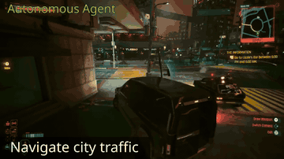

# NitroGen universal simulator

NitroGen's universal simulator is a Gymnasium wrapper that intercepts the game engine's system clock and "freezes the game while the model predicts".

*Recording of NitroGen playing Cyberpunk 2077 ("Navigate city traffic"), a 4 s excerpt from the project page's edited "Autonomous Agent" montage; no clock is shown, and the montage does not say whether the game was paused during inference. Source: [NitroGen project page (NVIDIA et al.)](https://nitrogen.minedojo.org/).*

| | |
|---|---|
| Year | Jan 2026 |
| Authors / org | NVIDIA and collaborators |
| Links | [arXiv 2601.02427](https://arxiv.org/abs/2601.02427) |
| Demo | [NitroGen page](https://nitrogen.minedojo.org/): project page with a pre-recorded montage captioned 'Autonomous Agent' (Rocket League, Cyberpunk 2077, Cuphead); the video does not show whether the game kept running or was paused during inference. Human-playable: no. Live model: no. The only Space found (community [blanchon/NitroGen-Pokemon](https://huggingface.co/spaces/blanchon/NitroGen-Pokemon)) was asleep. |
| Play mode | paused-live |
| Clock | intercepts engine clock, freezes game |
| Observation | 256x256 frame |
| Action | gamepad chunks of 16 |
| Players | 1 |
| Horizon | short tasks |
| Human reference | human-judged |
| Open source | weights + simulator released |
| Convertible to realtime-live | promising |
| Basis | code: `nitrogen/game_env.py` `async_mode=True` "Whether to pause/unpause the game during each step" (env pauses after each step); paper "freezes the game while the model predicts" |

## Details

- NitroGen (NVIDIA and collaborators), [arXiv 2601.02427](https://arxiv.org/abs/2601.02427): a Gymnasium wrapper that intercepts the game engine's system clock and "freezes the game while the model predicts"; real-time deployment is "left to future work". Released with weights.
- Convertibility: the NitroGen wrapper can in principle freeze for a budgeted time or run at a fraction of real speed, giving a controllable clock on arbitrary Windows games. In code (`nitrogen/game_env.py`) the pause is the `async_mode` switch, "Whether to pause/unpause the game during each step", default True; turning it off leaves the game running, which is the 1x unpaused route.
- NitroGen's clock interception is the practical route to controlling time in closed commercial games such as those used by Cradle and CombatVLA.

## Demo

- [video] [NitroGen project page](https://nitrogen.minedojo.org/) — Loaded the NVIDIA/Stanford/Caltech page and seeked all four autoplay videos (banner.mp4 20 s, dataset.mp4 20 s, annotations.mp4 30 s, rollouts.mp4 50.4 s); only static mp4 files were requested. banner, dataset and annotations show internet gameplay with gamepad overlays and the input-overlay action-extraction pipeline; rollouts.mp4 is labeled "Autonomous Agent" and shows NitroGen playing Rocket League ("Fast flip to reach the ball first"), Cyberpunk 2077 driving ("Navigate city traffic") and Cuphead ("Avoid enemies to reach a coin"). Play-mode evidence (recording): an edited montage with no latency or tick display; the page does not say whether the game was paused during inference. Links to arXiv 2601.02427, HF dataset nvidia/NitroGen, model weights and GitHub MineDojo/NitroGen (local inference only, no hosted demo).
- [dead-or-unreachable] [NitroGen-Pokemon Space (community)](https://huggingface.co/spaces/blanchon/NitroGen-Pokemon) — Found under "Spaces using nvidia/NitroGen"; status was "This Space is sleeping due to inactivity" and it was not restarted, so no app ran. Two other community Spaces (dennny123/NitroGen-SuperstarSaga, err805/NitroGen-SuperstarSaga) were not opened.

Visited 10 November 2026 in a headless browser.

Related: [NitroGen](../solutions/nitrogen.md) (the model); [Cradle](cradle.md); [Game-TARS](game-tars.md)
