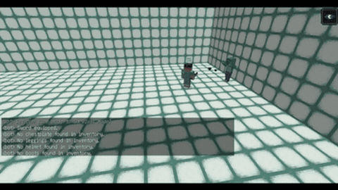

# Odyssey

Odyssey is a Minecraft code agent that writes Mineflayer JavaScript skills, with the server paused during LLM calls.

*Recording of the Odyssey agent fighting a zombie with a sword in a walled arena, with its skill outputs in the chat log ("Sword equipped.", "Killed zombie!"); a 6 s excerpt of the authors' spectator-mode demo, which the README says may be sped up. Source: [Odyssey README demo, combatDemo.mp4](https://github.com/zju-vipa/Odyssey#demo).*

| | |
|---|---|
| Year | 2023-25 |
| Demo | [README demo videos](https://github.com/zju-vipa/Odyssey#demo): four official recorded MP4s (mine diamonds, craft sword and fight a zombie, shear a sheep and milk a cow, autonomous exploration) of the Odyssey agent, filmed in Minecraft spectator mode and partly sped up. Recordings only, not human-playable; the combat clip shows server pause/unpause messages. |
| Play mode | scripted (Voyager, Odyssey: server paused during LLM calls) / realtime-live (MINDcraft) |
| Clock | server 20 TPS |
| Observation | structured state |
| Action | JS skills / commands |
| Players | 1+ |
| Horizon | long |
| Human reference | none |
| Open source | open |
| Convertible to realtime-live | restrict to low-level controls |
| Basis | Odyssey `odyssey/env/bridge.py:148,182` |

## Details

- Minecraft code agents: Voyager, Odyssey, MINDcraft.
- Voyager and Odyssey write Mineflayer JavaScript skills.
- Convertibility: the server already runs at 20 TPS and at least one harness runs unpaused (Parallelized Planning-Acting, [arXiv 2503.03505](https://arxiv.org/abs/2503.03505)). To make latency bite, restrict actions to low-level controls and score survival time or kills in a short arena. The high-level API otherwise hides all sensorimotor difficulty.

## Demo

- [official video] [Odyssey README "Demo" section](https://github.com/zju-vipa/Odyssey#demo) — Rendered the README and loaded the four linked MP4s from `Odyssey/images/`, seeking each to 10%, 50% and 90%. The README says "All demonstration videos were captured using the spectator mode within Minecraft. To comply with GitHub's file size restrictions, some videos have been accelerated." Captions and files: "Mining Diamonds from Scratch" (`mineDiamond.mp4`, 4:29), "Craft Sword and Combat Zombie" (`combatDemo.mp4`, 1:39), "Shear a Sheep and Milk a Cow" (`farmDemo.mp4`, 4:18), "Autonomous Exploration: (Only First Few Rounds)" (`exploreDemo.mp4`, 4:55). The frames show the "bot" player and a chat log of skill outputs such as "Crafted a wooden pickaxe.", "1 cobblestone mined.", "Placing crafting_table on stone at (33, 84, 338)" and "I can make stone_sword". Play-mode evidence (recording): at 90% of the combat clip, in a walled arena with a zombie, the chat shows "commands.pause.unpausing" and "serverpause.message.unpaused". This matches the file's label that the server is paused during LLM calls. The videos are edited and partly sped up, so they do not show a live run against a running clock.

Visited 10 November 2026 in a headless browser.

Related: [Voyager](voyager.md); [MINDcraft](mindcraft.md); [Mineflayer](mineflayer.md)
