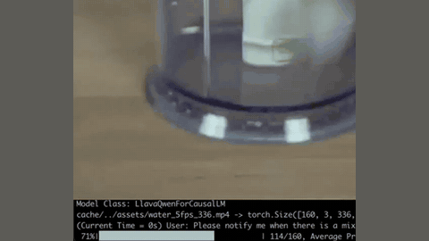

# OmniMMI

OmniMMI is an offline-replay benchmark that formalises streaming video as frames up to time t.

*Recording (cropped) of the authors' M4 proactive-generation demo: the model reads a 5 fps video and its terminal log reports "(Current Time = 23.6s) Assistant: The mixer appear at 20.6s" in answer to "Please notify me when there is a mixer." Source: [OmniMMI M4 page](https://omnimmi.github.io/m4.html).*

| | |
|---|---|
| Year | Mar 2025 |
| Links | [arXiv 2503.22952](https://arxiv.org/abs/2503.22952) |
| Demo | [project page](https://omnimmi.github.io) with six short example task clips (AP, SG, MD, SI, PA, PT) and a sortable leaderboard (no replays); [M4 page](https://omnimmi.github.io/m4.html) with two recorded screen captures of the M4 model running on a streaming video in a terminal. All recordings; nothing live or human-playable. |
| Play mode | offline replay |
| Clock | streaming video formalised as frames up to time t |
| Basis | paper §4 formalisation of "an input streaming video" |

## Details

- None of the streaming video benchmarks has actions; slow inference is not punished unless the metric is timing-aware (PAUC).

## Demo

- [project-page] [OmniMMI project page](https://omnimmi.github.io) — rendered it, forced the hidden example videos visible and seeked each to its midpoint. Six static MP4 clips illustrate the subtasks with question and answer text: ap.mp4 (15.6 s, "Task: Action Prediction (AP)"), sg.mp4 (9.5 s, "What is the current step in the rice cooking process?" with "1s-2s: Taking out rice", "3s-4s: Soaking and washing rice"), md.mp4 (4.7 s), si.mp4 (11.9 s, "Who welcomed someone to Top Notch?" / "Marie"), pa.mp4 (14.3 s, "Notify me when the man in a gray top is walking around a garden in the video." "[6s-14s]"; an orange "Alert!" overlay is visible at 0:07) and pt.mp4 (22.1 s). Below them are two sortable leaderboard tables (video LLMs and omni LLMs; e.g. Gemini-1.5-Pro 27.46 avg. w/o P, M4 12.46 with PA 25.50 and PT 62.00); scores only, no per-item replays. Play-mode evidence: the clips are annotated benchmark samples, not model runs.
- [official-video] [M4 page](https://omnimmi.github.io/m4.html) — seeked both videos and screenshotted frames. "Proactive Generation Demo" (demo_water_alert.mp4, 31.9 s; "Query: Please notify me when there is a mixer.") is a screen capture of the model processing a 5 fps video with a terminal log overlay: "Model Class: LlavaQwenForCausalLM", "water_5fps_336.mp4 -> torch.Size([160, 3, 336, 336]), 5 FPS", progress "119/160, Average Processing FPS: 5.4", and "(Current Time = 23.6s) Assistant: The mixer appear at 20.6s". "Proactive Turn-taking Demo" (demo_water_turntaking.mp4, 6.7 s) shows a terminal CLI conversation over local_demo/assets/water.mp4 ("max_new_tokens: 1024", "sample_frames: 32") where a new user query interrupts the answer. Play-mode evidence: recorded runs of a local demo; the frames are consumed from a file at roughly the video's 5 fps, and the alert lands 3 s after the event, consistent with streaming input but not scored against a running clock.

Visited 10 November 2026 in a headless browser.

Related: [OmniMMI / M4](../solutions/omnimmi-m4.md); [StreamingBench](streamingbench.md)
