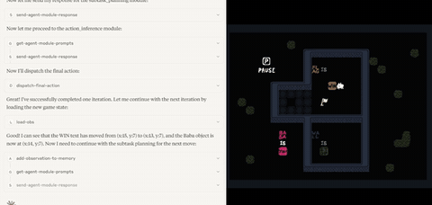

# Orak

Orak is a 12-game benchmark that pauses the game during inference, with a StarCraft II ablation that removes the pause.

*A screen recording of Claude Sonnet 4 calling Orak's MCP tools (load-obs, send-agent-module-response, dispatch-final-action) while Baba Is You waits behind a PAUSE overlay, then moves one step. Source: [Recording from the Orak leaderboard page, KRAFTON AI (Park et al., arXiv 2506.03610)](https://krafton-ai.github.io/orak-leaderboard/).*

| | |
|---|---|
| Year | 2025 |
| Authors / org | Park et al. (Krafton and others) |
| Links | [arXiv 2506.03610](https://arxiv.org/abs/2506.03610), [repo](https://github.com/krafton-ai/Orak) (MIT; six games need purchase) |
| Demo | [leaderboard](https://krafton-ai.github.io/orak-leaderboard/) + [YouTube promo](https://www.youtube.com/watch?v=2_tUJRrTYR0): a static leaderboard of 12 games plus Elo arena tables for SF3 and SC2, with two short recorded GIFs of Claude Desktop playing Ace Attorney and Baba Is You through MCP tool calls; the Baba Is You game shows a PAUSE overlay between steps, so the game waits for the model. No replays or live runs; human-playable: no. |
| Play mode | paused-live (main) + realtime-live (SC2 ablation, paper only) |
| Clock | game paused during inference; ablation enables real-time play |
| Observation | mostly text state |
| Action | macro actions |
| Players | mostly 1 |
| Horizon | mixed |
| Human reference | none |
| Open source | MIT; 6 paid games |
| Convertible to realtime-live | yes for SF3, Mario, SC2 |
| Basis | code: `src/mcp_game_servers/star_craft/game/utils/bots.py` `realtime=False`; paper App. K.4 "During LLM inference, we pause the StarCraft II game environment"; §5.7 "enabling real-time gameplay" (ablation code not in release branch, tag v0.1.0, PRs or 5 forks) |

## Details

- Park et al. (Krafton and others), [arXiv 2506.03610](https://arxiv.org/abs/2506.03610); [repo](https://github.com/krafton-ai/Orak) (MIT; six games need purchase).
- 12 games. The appendix states the game is paused during inference for Street Fighter III, Super Mario, StarCraft II and Stardew Valley. The StarCraft II pause is confirmed in code: `run_game(..., realtime=False)` plus an `isReadyForNextStep` event handshake between the bot and the environment process. Minecraft uses Mineflayer JavaScript. Observations are mostly text; actions are macros (Mario: only a jump level while Mario auto-runs).
- Convertibility: the pause is a harness addition and the authors' own ablation removes it for StarCraft II (scores to 0). Text state and macro actions make it a strategy-latency test, not a sensorimotor one.
- **Orak StarCraft II ablation** (v3, Apr 2026), [arXiv 2506.03610](https://arxiv.org/abs/2506.03610): against the Hard built-in AI, paused scores of 75 / 100 / 100 (GPT-4o-mini, GPT-4o, Gemini 2.5 Pro) all fall to 0 unpaused, at 20-99 s per step. Section 5.7 says only that real-time gameplay was enabled; it does not describe the mechanism. The public repo (last commit June 2025, before the ablation) hard-codes `realtime=False` in `src/mcp_game_servers/star_craft/game/utils/bots.py`, so the realtime variant cannot be checked in code.
- Orak uses gym-super-mario-bros and states it requires pausing.

## Demo

- [leaderboard] [Orak leaderboard](https://krafton-ai.github.io/orak-leaderboard/) — Opened the page, clicked both tabs and downloaded its two GIFs (each 359 frames, 14.96 s). It is a static leaderboard (last updated 2025.06.09) of mean ± std scores across 12 games for about 20 model / agentic-strategy pairs (Gemini-2.5-pro first, average rank 3.9) and a 'Battle Arena' tab of Elo for SF3 and SC2 (Minitron-8B top in SF3 at 1680). The GIFs 'Claude playing Ace Attorney' (Claude 3.7 Sonnet) and 'Claude playing Baba Is You' (Claude Sonnet 4) are screen recordings of Claude Desktop calling MCP tools (load-obs, get-agent-module-prompts, send-agent-module-response, dispatch-final-action) beside the game window. Play-mode evidence (recording): in Baba Is You the game shows a 'PAUSE' overlay while Claude makes tool calls, then reports 'successfully completed one iteration... loading the new game state'; Ace Attorney shows step-by-step simulated key inputs ('Simulated GetKeyDown input detected for key: A') with the game idle between calls. Network requests were static files only; no replay viewer, interactive play or live model.
- [video] [Orak YouTube promo](https://www.youtube.com/watch?v=2_tUJRrTYR0) — Opened the KRAFTON promo 'Orak Benchmark / From Talking to Playing: Can LLMs Really Game?' (2:00) but it would not play in headless Chrome (embed Error 153, watch page stuck at 0), so only the thumbnail (a grid of game screenshots) was seen. Play-mode evidence: unknown; it is a promotional edit, not a live run.

Visited 10 November 2026 in a headless browser.

Related: [Orak fine-tuning](../solutions/orak-fine-tuning.md); [gym-super-mario-bros](gym-super-mario-bros.md); [PySC2 / python-sc2](pysc2-python-sc2.md); [Mineflayer](mineflayer.md)
