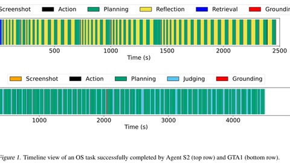

# OSWorld-Human

OSWorld-Human is "The First CUA Latency Study", measuring planning and reflection latency per step while the environment waits.

*Paper figure (Figure 1): per-step timeline of one OS task (creating an SSH user) completed by Agent S2 (top, about 2,500 s) and GTA1 (bottom, about 4,500 s), showing that LLM planning, reflection and judging calls take up most of the wall-clock time. Source: [Abhyankar, Qi and Zhang, arXiv 2506.16042](https://arxiv.org/abs/2506.16042).*

| | |
|---|---|
| Year | Jun 2025 |
| Links | [arXiv 2506.16042](https://arxiv.org/abs/2506.16042) |
| Demo | [Blog post / project page](https://mlsys.wuklab.io/posts/oshuman) with an animated GIF schematic of Agent S2's per-step pipeline and interactive latency and step-count charts. It does not record an agent using a real desktop, and there is no replay viewer or playable page. The [repo](https://github.com/WukLab/osworld-human) has a static leaderboard. |
| Play mode | paused-live |
| Clock | the environment waits; latency measured afterwards |
| Basis | paper §3: "The First CUA Latency Study" measures planning/reflection latency per step |

## Details

- OSWorld-Human: agents take 1.4-4.3 times more steps than a human trajectory; planning and reflection calls dominate latency.

## Demo

- [project-page] [MLSys @ WukLab blog post](https://mlsys.wuklab.io/posts/oshuman): I found it through the README of [WukLab/osworld-human](https://github.com/WukLab/osworld-human), rendered it, and pulled frames from its one GIF (blog-fast.gif, 1920x1080, 28 frames, about 27 s). The GIF is an animated slide-style diagram, not screen capture. A user asks "Highlight and underline the first paragraph", and Agent S2 steps through its pipeline, for example "5. Ground action to coordinates with small model" emitting "MOVE_TO(400, 560)", then ends with "Done!". The page also shows a "👤 Human ~2 min" vs "🤖 Agent ~20+ min" panel and interactive charts: "Application Action Breakdown" (Screenshot, Action, Planning, Reflection, Retrieval, Grounding, per app) and "Application Actions: Single vs. Grouped". Play-mode evidence: there is no live or recorded agent run. The latency figures are measured afterwards, which fits the paused-live label.
- [leaderboard] [GitHub README leaderboard](https://github.com/WukLab/osworld-human): a static table ("Updated 6/30") of 6 agents with Original OSWorld, Single-Action WES+, Grouped-Action WES+ and WES- scores, for example UI-TARS-1.5 (100) at 42.5 / 23.7 / 14.3 / -0.22. It has no replays or trajectories to view.
- The [MLSys 2026 oral page](https://mlsys.org/virtual/2026/oral/3865) loads the SlidesLive embed script, but no presentation video rendered in the headless browser.

Visited 10 November 2026 in a headless browser.

Related: [OSWorld 2.0](osworld-2.md)
