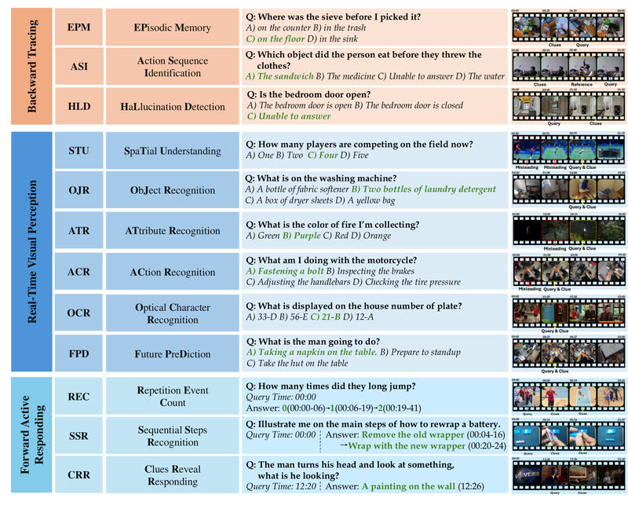

# OVO-Bench

OVO-Bench is an offline-replay streaming video benchmark with query timestamps.

*Paper figure (not footage) showing one example question per task in the three groups (Backward Tracing, Real-Time Visual Perception, Forward Active Responding), each with a film strip marking the clue, query and misleading timestamps. Source: [Li et al., OVO-Bench (arXiv 2501.05510), Figure 2](https://arxiv.org/abs/2501.05510).*

| | |
|---|---|
| Year | Jan 2025 |
| Links | [arXiv 2501.05510](https://arxiv.org/abs/2501.05510) |
| Demo | None found (searched: arXiv abstract page and comments, GitHub repo JoeLeelyf/OVO-Bench and its homepage field, the project page https://joeleelyf.github.io/OVO-Bench/, which has only static figures: no videos, GIFs, replay viewer or live demo) |
| Play mode | offline replay |
| Clock | query timestamps |
| Basis | paper §1: "the timestamp when a question is raised"; §8.2 "Query Timestamps" |

## Details

- None of the streaming video benchmarks has actions; slow inference is not punished unless the metric is timing-aware (PAUC).

## Demo

- None found. The repo's homepage field points to the project page [joeleelyf.github.io/OVO-Bench](https://joeleelyf.github.io/OVO-Bench/), which I rendered: it has no video, iframe or canvas elements, only static PNG figures (taxonomy, statistics, a leaderboard image, and a carousel of example sheets such as example_1.png showing "[EPM] Episodic Memory" and "[HLD] Hallucination Detection" film strips annotated with "Clue Time" / "Query Time" stamps), plus links to the code, arXiv, paper PDF and Hugging Face dataset. The arXiv comments field says only "CVPR 2025". Nothing shows a model answering along a running video stream.

Searched 10 November 2026; no demo found.

Related: [StreamingBench](streamingbench.md); [OmniMMI](omnimmi.md)
