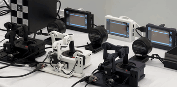

# Physical Atari

Physical Atari runs ALE free-running at 60 Hz, played by a robot at 30 FPS with about 165 ms latency through a physical joystick.

*A 4 s recording (cropped, real speed) of three Robotrollers moving CX40+ joysticks while three Atari Devbox screens show the games; no clock is visible. Source: [Keen Technologies, Physical Atari project page](https://keenagi.com/research/physical-atari/).*

| | |
|---|---|
| Year | Jun 2026 |
| Authors / org | Javed, Modayil, Kennickell, Sutton, Carmack |
| Links | [arXiv 2606.19357](https://arxiv.org/abs/2606.19357) |
| Demo | [Keen Technologies project page](https://keenagi.com/research/physical-atari/): project page with a 15 s autoplaying, looping video ("learning.mov") of three Robotrollers moving CX40+ joysticks while three Atari Devbox screens show the games, plus photo assembly guides for the Robotroller and Devbox. A recording of the robots playing live; no replay viewer, no score or clock readout, not human-playable. |
| Play mode | realtime-live |
| Clock | ALE free-running 60 Hz, agent 30 FPS, 165 ms latency |
| Observation | camera |
| Action | physical joystick |
| Players | 1 |
| Horizon | minutes |
| Human reference | n/a |
| Open source | repo named |
| Convertible to realtime-live | n/a |
| Basis | paper §1: benchmarks where "the environment waits for the agent" contrasted with real-time RL; App.: Devbox "renders Atari 2600 games at 60 FPS, listens to the actions from the CX40+ controller" |

## Details

- **Physical Atari** (Javed, Modayil, Kennickell, Sutton, Carmack, 2026), [arXiv 2606.19357](https://arxiv.org/abs/2606.19357): ALE free-running at 60 Hz, a robot at 30 FPS with about 165 ms latency. Evidence that unpaused Atari is a live research setting.
- Atari has already been run unpaused with RL: fixed action delays (Firoiu et al.) and Physical Atari.

## Demo

- [project-page video] [Physical Atari, Keen Technologies](https://keenagi.com/research/physical-atari/) (found via the [Keen-Technologies/physical_atari](https://github.com/Keen-Technologies/physical_atari) README's Robotroller link; the repo has no homepage field) — Opened the page, which has the paper title, authors, "PAPER" (static/physical_atari.pdf) and "CODE" ([Keen-Technologies/physical-atari-rlc](https://github.com/Keen-Technologies/physical-atari-rlc)) links and one video, static/learning.mov (1920x1080, 14.8 s, autoplay and loop). I paused and seeked to 1, 5, 9 and 13 s and screenshotted each frame: a fixed camera shot of three Robotrollers (black, white, navy) gripping CX40+ joysticks, with three small Devbox screens showing a Pong-like game and a tower PC with the Keen "k_" logo behind them. Between frames the robot arms and joysticks change position and the on-screen game objects move. Play-mode evidence (recording): the agents act on the running game through physical joysticks, consistent with realtime-live, but the clip shows no tick counter, score, timestamp or latency readout, and the page does not caption it. The network log shows only the static .mov file being fetched; there are no live model calls.
- [assembly guides] [Robotroller](https://keenagi.com/research/physical-atari/robotroller.html) and [Atari Devbox](https://keenagi.com/research/physical-atari/devbox.html) — opened both; they are step-by-step photo guides (for example Baseplate_1.webp, Shoulder_1.webp; Front.webp, FrontHeatSink1.webp) with no video and no gameplay.

Visited 10 November 2026 in a headless browser.

Related: [ALE / Atari](ale-atari.md)
