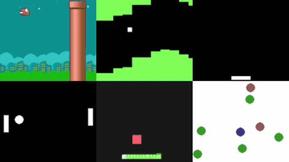

# PLE

PLE (PyGame Learning Environment) is a set of tiny games with text-serialisable state and one or two buttons.

*Recordings of six PLE games (Flappy Bird, Pixelcopter, Catcher, Pong, Snake, WaterWorld), rearranged by cropping the maintainers' separate docs GIFs, resampling them to 10 fps and tiling them in one grid, with no agent, score or clock shown. Source: [PLE docs GIFs (ntasfi/PyGame-Learning-Environment)](https://github.com/ntasfi/PyGame-Learning-Environment/tree/master/docs/_static).*

| | |
|---|---|
| Year | Feb 2016 |
| Demo | [docs game GIFs](https://github.com/ntasfi/PyGame-Learning-Environment/tree/master/docs/_static) (also on the [games docs page](http://pygame-learning-environment.readthedocs.org/en/latest/user/games.html)): looping animated GIFs of each of the 10 games running. They are recordings with no model, score or clock shown; there is no browser-playable version, live demo or replay viewer. |
| Play mode | paused-live (Dino browser is realtime-live) |
| Clock | STEP at about 30 fps |
| Observation | numeric state or pixels |
| Action | 1-few buttons |
| Players | 1 |
| Horizon | seconds |
| Human reference | easy |
| Open source | MIT |
| Convertible to realtime-live | high |
| Basis | PLE `ple.py` `force_fps=True` default |

## Details

- **Flappy Bird**, **PLE**, **MinAtar**, **PyBoy**: tiny, text-serialisable state, one or two buttons. Ideal for latency-versus-score curves.

## Demo

- [video/GIF] [PLE docs game GIFs](https://github.com/ntasfi/PyGame-Learning-Environment/tree/master/docs/_static): the readthedocs games page (`user/games.html`, one page per game with `.. image:: /_static/<game>.gif`) showed a Cloudflare "Performing security verification" wall in headless Chrome, so I loaded the same GIFs from the repo's `docs/_static/` (flappybird 288x512, pixelcopter, catcher, pong, snake, monsterkong 500x464, puckworld, waterworld, raycastmaze, doom 320x240) and took screenshots 2 s apart. The frames change (the Flappy Bird background goes from day to night, the snake moves, the Pong ball moves), so these are looping gameplay recordings. They are not captioned and show no agent identity, score, tick counter or timing, and nothing in them involves an LLM. Play-mode evidence: none. The GIFs do not show whether frames were forced (`force_fps`) or paced in real time.
- [video/GIF] [README banner `ple_games.jpg`](https://github.com/ntasfi/PyGame-Learning-Environment): a static 800x515 montage of six game screens (raycast maze, Flappy Bird, Pixelcopter, PuckWorld, Pong, WaterWorld). It is a still image, not a demo.

Visited 10 November 2026 in a headless browser.

Related: [Flappy Bird](flappy-bird.md); [Chrome Dino](chrome-dino.md); [MinAtar](minatar.md); [PyBoy](pyboy.md)
