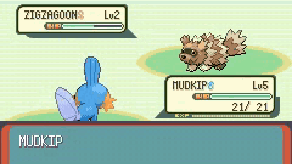

# PokeAgent Challenge, speedrunning track

The PokeAgent speedrunning track asks agents to play Pokemon Emerald to the first gym in real time, ranked by completion, then wall-clock time, then action count.

*A recording of the winning team Heatz's agent in its first Pokemon Emerald battle: it picks FIGHT, then TACKLE, against a wild Zigzagoon. The video is edited from the 40:13 run, so no clock is visible. Source: [Footage: team Heatz (uploader Junik Bae), winning PokeAgent Challenge speedrun submission video, linked from the official leaderboard at pokeagent.github.io/leaderboard.html](https://youtu.be/A28OJRl3R8o).*

| | |
|---|---|
| Year | 2025-26 |
| Authors / org | Karten, Grigsby and others (Princeton, UT Austin) |
| Links | [arXiv 2603.15563](https://arxiv.org/abs/2603.15563) |
| Demo | [site](https://pokeagentchallenge.com/speedrunning.html), [leaderboard](https://pokeagent.github.io/leaderboard.html): static track page plus a final first-gym leaderboard (winner Heatz, 40:13 wall-clock) where each entry links to a team-uploaded YouTube screen recording (e.g. [Heatz](https://youtu.be/A28OJRl3R8o)) of the agent's Emerald run. All are recorded runs, nothing is live or interactive, and the winning video is edited to 12 min, so it cannot show the real-time clock. Battle [replays](https://replays.pokeagentchallenge.com/) cover the battling track only. Human-playable: no. |
| Play mode | realtime-live (winners used scripted) |
| Clock | WALL incl. inference |
| Observation | frames + state |
| Action | button presses |
| Players | 1 |
| Horizon | 20 min to hours |
| Human reference | top 18 min, average 1:22:05 |
| Open source | paper CC BY-NC-SA 4.0; starter repo open |
| Convertible to realtime-live | n/a |
| Basis | paper Fig. 7: "our environment runs in real time—the game world continues while the agent reasons" |

## Details

- PokeAgent Challenge, speedrunning track (NeurIPS 2025 competition; paper Mar 2026).
- Karten, Grigsby and others (Princeton, UT Austin). [arXiv 2603.15563](https://arxiv.org/abs/2603.15563).
- Task: Pokemon Emerald to the first gym, 15 milestones. Realtime-live: the paper states the game continues while the agent reasons; ranking is completion, then wall-clock time, then action count.
- Human reference: top speedrunner 18 minutes; average human 1:22:05.
- Results: winner 40:13 using LLM-written scripted sub-policies distilled into networks and refined with RL, so the model was not in the loop during play. Best pure-LLM harness 1:29:17. Raw VLMs without a harness about 0%.
- **PokeAgent speedrun winners** and **DPT-Agent's FSM** are scripted solutions inside realtime environments (see [DPT-Agent Overcooked](dpt-agent-overcooked.md)).

## Demo

- [project-page] [PokeAgent speedrunning page](https://pokeagentchallenge.com/speedrunning.html) — Opened the home and Speedrunning pages: a static page with a "Real-Time Agent Loop" diagram, a link to the starter kit (github.com/sethkarten/pokeagent-speedrun), submission rules and ranking criteria; no video, canvas or playable emulator. Leaderboard entries must include "a video recording of your agent playing Pokemon Emerald". Play-mode evidence (text only): the starter kit has a "custom emulator API for real-time game interaction" and ranking is by "number of actions and time".
- [leaderboard] [PokeAgent NeurIPS 2025 leaderboard](https://pokeagent.github.io/leaderboard.html) — Read Track 2: RPG Speedrunning (first-gym scope, Jul 11 to Nov 15, 2025): 1 Heatz 100% in 40:13, 2 Hamburg PokeRunners 1:14:43, 3 anthonys 1:29:17, 4 Evelord 1:48:50, 5 Deepest 2:04:29, 19 rows in total, each linking to a YouTube screen recording or splits; the Milestone Splits view could not be opened. Rules required submission.log action/state logs and that "the final action comes from a neural network". Play-mode evidence: all entries are after-the-fact recordings; the "Total Runtime" column is wall-clock time, but there is no tick or latency counter.
- [video] [Heatz winning run on YouTube](https://youtu.be/A28OJRl3R8o) — Opened the winning video ("part 1 & 2", 727 s, uploader Junik Bae); only the first frame rendered in headless Chrome (Professor Birch's intro, plain emulator screen with no overlay or timer). Also read metadata of other entries: Hamburger PokeRunners "Phase 1: Startscreen to Truck" (103 s), anthonys "part2 final" (1963 s), Deepest "GAME START to FIRST_GYM_COMPLETE" (6688 s) and Joel Woodfield's "pokegent recording" (15426 s). Play-mode evidence (recordings): Heatz's 12:07 video against a 40:13 runtime is cut or sped up, so it cannot show whether the game kept running while the model thought; Deepest's 1:51:28 video against 2:04:29 fits an unedited wall-clock recording.
- [replay-viewer] [PokeAgent battle replays](https://replays.pokeagentchallenge.com/) — Not opened: it holds Showdown battle replays for Track 1 (battling), not the Emerald speedrun. No play-mode evidence for this track.

Visited 10 November 2026 in a headless browser.

## Fit

realtime yes; verifiable yes; single yes; human-easy yes; short no. Wall-clock time here is dominated by menus and navigation, not reaction. The lesson is that scripted routes win when allowed.

Related: [Pokemon stream harnesses](pokemon-stream-harnesses.md); [SpeedrunBench](speedrunbench.md)
