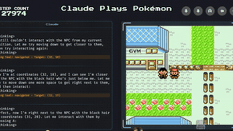

# Pokemon stream harnesses

The Pokemon stream harnesses (ClaudePlaysPokemonStarter, the FireRed harness) play Pokemon with button tool calls while the game waits for input.

*Recording (6 s, real time) from a Claude Plays Pokemon Twitch clip of the production stream harness, not the starter: Claude's reasoning and tool calls stream into the left panel while the step count stays at 27974 and the Game Boy screen stays still. Source: [ClaudePlaysPokemon on Twitch](https://www.twitch.tv/claudeplayspokemon/clip/DiligentWildVampireWoofer-7QnY4Da4FuDgFKiM).*

| | |
|---|---|
| Year | 2025-26 |
| Links | [starter repo](https://github.com/davidhershey/ClaudePlaysPokemonStarter) |
| Demo | [ClaudePlaysPokemon Twitch](https://www.twitch.tv/claudeplayspokemon) (offline; recorded clips such as [this one](https://www.twitch.tv/claudeplayspokemon/clip/DiligentWildVampireWoofer-7QnY4Da4FuDgFKiM)) and the [GPT Plays Pokémon companion site](https://gpt-plays-pokemon.clad3815.dev/) (run stats and milestones for Clad3815's FireRed and other runs). These are recordings and run logs of the stream harnesses, not the starter; the clips show the step counter frozen while Claude thinks. Human-playable: no. |
| Play mode | paused-live |
| Clock | emulator ticked only inside tool calls (starter); input-driven RPG (FireRed harness) |
| Observation | screenshot + RAM |
| Action | button tool calls |
| Players | 1 |
| Horizon | 100s of hours |
| Human reference | none |
| Open source | starter and FireRed harness open; Gemini harness not public |
| Convertible to realtime-live | low value |
| Basis | code: ClaudePlaysPokemonStarter `agent/emulator.py` (`pyboy.tick()` only in button handlers); Clad3815/gpt-play-pokemon-firered `server/src/core/gameLoop.js` (state -> LLM -> keys; mGBA unpaused but game waits for input); PokeAgent paper: "X Plays Pokémon systems all freeze the emulator between actions" |

## Details

- Listed in the turn-based or untimed contrast set: none has a native clock; a deadline could be imposed but the games do not reward reflexes. They are useful as the "same model, no clock" control.
- Not reviewable (see [index](README.md#not-reviewable)): the Gemini Plays Pokemon harness and the production Claude Plays Pokemon stream harness; only the public starter (ClaudePlaysPokemonStarter) is reviewed here.

## Demo

- [video] [ClaudePlaysPokemon Twitch channel](https://www.twitch.tv/claudeplayspokemon) and [clip "Claude jumps back to Cerulean city"](https://www.twitch.tv/claudeplayspokemon/clip/DiligentWildVampireWoofer-7QnY4Da4FuDgFKiM) — Opened the channel (shows "OFFLINE", "last live 6 months ago"), listed its clips and played the top 25 s clip (29.2K views, "2 years ago", Pokémon Red/Blue), screenshotting at t=7, 14 and 21 s. The stream overlay shows "STEP COUNT 27974", a Claude panel with <thinking> text and tool lines such as "Using tool: navigator - Target: (32, 19)" and "Using tool: use_emulator - Buttons: ['a', 'wait']", the Game Boy screen, a recent-button strip and the party (Puff, Sprou, Sand). This is the production Claude Plays Pokemon harness, not the starter. Play-mode evidence (recording): the step count stayed at 27974 and the player sprite did not move between frames while new reasoning text streamed in, consistent with the game waiting between tool calls.
- [run log] [GPT Plays Pokémon companion site](https://gpt-plays-pokemon.clad3815.dev/) — Opened it, expanded every "Milestones & time breakdown" panel and read the links. It lists five finished GPT-6 Astra runs (HeartGold, Crystal Ironlocke, FireRed, Emerald, Crystal Hard) with active runtime, total tokens, badges and per-milestone times; FireRed: "Active runtime 21h 03m", "Total tokens 499M", "3.6K action calls", split into "Thinking 0h 51m", "Generation 3h 27m", "Gameplay 16h 44m", Champion at "20h 58m active". Its page header reads "Updates delayed · 15 Sept, 19:50 UTC", the hero video box rendered black, and its "Watch on Twitch" link (twitch.tv/gpt_plays_pokemon) returned "that content is unavailable"; Clad3815's own channel was offline. Play-mode evidence: the site says "Active runtime excludes interruptions" and separates thinking and generation time from gameplay time, so model time is counted apart from game time; no live clock is visible.

Visited 10 November 2026 in a headless browser.

Related: [PokeAgent Challenge, speedrunning track](pokeagent-speedrun.md); [PyBoy](pyboy.md)
