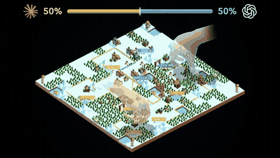

# Polytopia Bench

Polytopia Bench gives each model 40 minutes to write a Rust bot for 1v1 The Battle of Polytopia, then grades the frozen bot over 360 games against six fixed opponents, up to a self-play reinforcement learning (RL) champion.

*Model-written bots playing each other in the benchmark's launch video (an Anthropic-logo bot against an OpenAI-logo bot, then a Kimi bot against a Gemini bot; the video shows only company logos, not model versions), with a win-share bar above each board; a stylised recording of replays with animated hands moving the pieces, not live play. Source: [Kevin Zhang (@kzdagoof), "Introducing Polytopia Bench" post on X, 2 November 2026](https://x.com/kzdagoof/status/2117257994232881492).*

| | |
|---|---|
| Year | Oct 2026 |
| Authors / org | Kevin Zhang (personal project; no affiliation stated) |
| Links | write-up [*Introducing Polytopia Bench*](https://thekevinz.com/blog/polytopia-bench) (dated 31 October 2026), code and full archive in [kevinz917/superhuman-polytopia-bot `benchmark/`](https://github.com/kevinz917/superhuman-polytopia-bot/tree/main/benchmark) (Apache 2.0), [launch post on X](https://x.com/kzdagoof/status/2117257994232881492); no paper |
| Demo | [interactive leaderboard](https://thekevinz.com/blog/polytopia-bench) in the write-up (filter by opponent and map family, inspect each model's five bots); [hosted Studio](https://polytopia-bot-kappa.vercel.app) where a human plays 1v1 against the RL bots used as the top opponent (not against the model-written bots). Human-playable: yes (Studio). |
| Play mode | scripted |
| Clock | authoring: 40 active minutes of wall-clock time, API latency included; games: turn-based, the referee waits for each bot decision, capped at 2 s per decision (timeout = forfeit) and 1,800 s per game |
| Observation | model: rule book, starter code, practice traces; bot: JSON observation with fog of war and the legal action list |
| Action | model: Rust source code; bot: one legal action ID per call |
| Players | 2 (written bot vs a fixed reference bot) |
| Horizon | 40 min to write; each game up to 200 rounds or 40,000 actions |
| Human reference | none |
| Open source | Apache 2.0: harness, conversations, all bots, replays, reference weights |
| Convertible to realtime-live | not meaningful (turn-based 4X; the model never plays a move) |
| Basis | write-up: "The bot itself is a Rust program that reads a JSON observation on stdin and writes back the id of one legal action"; code: `benchmark/runner/src/polytopia_bot/skirmish/game.py:80-85` (referee calls `bots[player].select(obs)`; a `BotFault` is a forfeit), `wasi.py:43` (`decision_timeout`), `configs/skirmish/continuous-v1.json` (`coding_seconds: 2400`, `move_seconds: 2.0`, `max_rounds: 200`) |

## Details

- Polytopia Bench (31 October 2026; launch post 2 November 2026; Claude Fable 5.2 added 10 November 2026). By Kevin Zhang, as a follow-up to his self-play RL Polytopia bot in the same repository.
- What it tests: how strong a game-playing program a coding agent can write in a fixed time. The game is a 1v1 version of The Battle of Polytopia (turn-based 4X strategy with fog of war) on 14x14 maps, run by the author's Rust re-implementation of the game's rules (version 2.17.3, Bardur tribe), not the commercial game.
- How a run works. Each attempt is one 40-minute session in an offline sandbox with the rule book, the bot protocol, a starter `main.rs`, nine public practice maps and a command-line tool to compile, play practice games against a public greedy bot and step through traces. Reading, editing, compiling, practice and API latency all count against the 40 minutes; setup and grading do not. At the deadline the current source is frozen and compiled to WebAssembly.
- How a game runs. A separate verifier plays the frozen bot against six opponents (two earlier frozen LLM-written bots, a scripted siege player, two blends that hand 25% or 50% of turns to the RL champion, and the full champion) on three map families (drylands, lakes, continents) x ten held-out layouts x both seats = 360 games. The referee loop asks the player whose turn it is for one action, then steps the engine. The bot gets 2 s per decision and 256 MiB of memory; a crash, timeout or illegal action forfeits the game. Games reaching 200 rounds or 40,000 actions are draws. Every game is replay-audited before it counts.
- Scoring: panel points = 100 x (wins + half of draws) / 360, reported as mean and sample standard deviation over five independently written bots per model.
- Results (13 models, 65 bots, 23,400 games): GPT-6 Astra 74.94 ± 6.02 points, GPT-6.1 Sol 74.39 ± 2.92, Gemini 4 Argon 64.36 ± 5.80, Claude Fable 5.2 54.33 ± 11.96, Claude Opus 5.5 43.42 ± 3.59, down to MiniMax M3.1 Flash 13.08 ± 11.28. Against the full RL champion the best models win only 8-9 of 300 games (about 3%); the write-up says that in the original 12-model cohort the champion lost 41 of 3,600 games and won all 1,200 of its drylands games.
- Findings from the write-up: the first eight turns decide most games; weak bots froze on one bad constant (for example, research always scored above recruiting); strong bots used shortest-path search, a threat map ("danger term") and one target per unit. More practice games did not help on their own.
- Time limits: the only clocks are the 40-minute authoring budget (which charges the model's thinking time, a design worth noting) and the 2 s per-decision cap on the compiled bot, which is a compute limit on a program, not a running game clock. The game itself never advances while anyone thinks.
- Caveats: the Claude Fable 5.2 follow-up replaced two interrupted sessions (disclosed in the repo); costs are partly unavailable (subscription proxies). There is no human baseline for the benchmark task.
- A different project with the same name, [chaber15/polytopia-bench](https://github.com/chaber15/polytopia-bench), has models play the commercial game turn by turn through a game plugin against two Hard computer players for 30 turns (paused-live by its README; it was not reviewed further here). The X post this entry comes from is the kevinz917 benchmark.

## Demo

- [leaderboard] [Introducing Polytopia Bench](https://thekevinz.com/blog/polytopia-bench) — Read the page. An interactive bar chart ranks 13 models by panel points (five dots per model, one per bot), with opponent and map-family filters; selecting a model shows its five submissions and win/draw/loss totals (GPT-6 Astra: 1,800 games, 1,348 wins, 2 draws, 450 losses). A per-opponent table and a unit-mix chart follow. No game replays are embedded. Play-mode evidence: the page states that each model writes a program and that the program, not the model, picks every move.
- [human-play] [Polytopia Bot Studio](https://polytopia-bot-kappa.vercel.app) — Started a game against "Plato" (the strongest RL bot) without signing in; the board loaded at turn 1 with one city and 5 stars, and play is by clicking units and pressing Next Turn. It is untimed and turn-based. This shows the opponent side and the game engine, not the benchmark's model-written bots.
- [recording] [Launch video on X](https://x.com/kzdagoof/status/2117257994232881492) — about 20 s, 1920x1080: model-vs-model bot games on stylised boards with win-share bars, then the leaderboard animating. Fetched through the public embed without signing in.

Visited 10 November 2026 in a headless browser.

## Fit

realtime no (turn-based, and the model only writes code); verifiable yes (audited win/draw/loss); single no (1v1 against fixed bots); human-easy partly (Polytopia is a casual game, but no human baseline); short no (40 minutes of authoring, games up to 200 rounds). Worth copying: charging API latency against a fixed authoring budget, the fixed graded opponent ladder, and the per-decision timeout that forfeits. Not a realtime environment.

Related: [CivBench](civbench.md); [CivRealm](civrealm.md); [Kaggle Game Arena](kaggle-game-arena.md); [SnakeBench](snakebench.md); [CodeClash](codeclash.md) (also models writing game bots); [microRTS](microrts.md)
