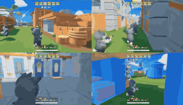

# PORTAL

In PORTAL the LLM writes behaviour trees.

*Recording of LLM-written behaviour-tree policies playing four different third-person FPS games in real time (match timers at top), cropped to the top-left 2x2 of the authors' 3x3 "team attack" montage. Source: [PORTAL project page](https://zhongwen.one/projects/portal).*

| | |
|---|---|
| Links | [arXiv 2503.13356](https://arxiv.org/abs/2503.13356) |
| Demo | [project page](https://zhongwen.one/projects/portal): three ~8 s recorded YouTube montages (3x3 grids of FPS UGC game clips) of LLM-generated behaviour-tree policies running in real time, plus downloadable BT DSL/JSON examples; the LLM writes the tree offline and is not in the per-frame loop; no code or interactive demo; human-playable: no. |
| Play mode | scripted |

## Details

- **PORTAL** ([arXiv 2503.13356](https://arxiv.org/abs/2503.13356)): the LLM writes behaviour trees.

## Demo

- [video] [PORTAL project page](https://zhongwen.one/projects/portal) — Loaded the page and opened its three embedded YouTube videos (MtJFJrqdigw "Basic", HxANid-DXnE "team attack", 2Kv06PUL-MQ "Demo video for taking advantage point"), each 8.06 s, seeked to 10/40/70/95% and fetched the linked team_attack DSL file; all seen in recordings. Each video is an edited 3x3 grid of clips from different third-person FPS UGC games (Tencent) with cartoon cat characters, and each example links a BT illustration PNG, a DSL (.md) and a JSON; the DSL is a static behaviour tree with conditions such as has_enemy_in_view and task nodes such as shoot_enemy_who_is_in_view_and_is_closest. The page says copyright prevents demos across the thousands of games tested. Play-mode evidence: in-game HUDs show match countdown timers (59:30, 57:30), so matches run in real time, but the LLM is not in the loop during play; it writes the tree offline and refinement happens between episodes via Reflexion, and nothing shows LLM latency or live calls.

Visited 10 November 2026 in a headless browser.

Related: [PORTAL](../solutions/portal.md)
