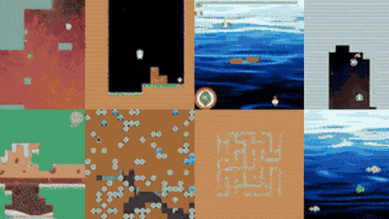

# Procgen

Procgen is a set of 16 procedurally generated games with a human rate of 15 Hz and a very fast simulator.

*A recording of eight of the 16 Procgen games playing side by side, cropped to the top half of the repo's 4x4 grid; the README does not say whether an agent or a human is playing. Source: [openai/procgen README](https://github.com/openai/procgen).*

| | |
|---|---|
| Year | 2019 |
| Links | [repo](https://github.com/openai/procgen) |
| Demo | [blog](https://openai.com/blog/procgen-benchmark/): 16 looping MP4 env clips; the post doesn't say whether agent or human plays them. The live page is behind a Cloudflare 403, so it was viewed via the Wayback Machine. Synchronous gym env, so the game waits for the agent. Human-playable: locally via procgen.interactive, not in browser. |
| Play mode | paused-live |
| Clock | STEP; human rate 15 Hz |
| Observation | 64x64 pixels |
| Action | 15 discrete |
| Players | 1 |
| Horizon | 30-60 s |
| Human reference | easy |
| Open source | MIT |
| Convertible to realtime-live | high |
| Basis | code: `procgen/src/vecgame.cpp` (workers call `game->step()` only on act); README "expected step rate for a human player is 15 Hz" |

## Details

- **Procgen** ([repo](https://github.com/openai/procgen)): 16 games, human rate 15 Hz, very fast simulator. 64x64 pixels are hard for VLMs and no text state is exposed.

## Demo

- [project-page] [Procgen Benchmark blog post](https://openai.com/blog/procgen-benchmark/) — The live openai.com page returned HTTP 403 (Cloudflare 'Just a moment...'), so I read the Wayback Machine copy (Jan 2021 capture) instead. The post (Dec 3, 2019) has 16 procedurally generated environments with one looping MP4 clip each (cdn.openai.com/procgen-benchmark/assets/env_coinrun.mp4, env_starpilot.mp4, ... env_bossfight.mp4) and getting-started commands including 'python -m procgen.interactive --env-name starpilot # human' and a random-agent gym loop. Play-mode evidence (recording): pre-recorded clips that do not say whether an agent or a human plays; nothing on the page is live.

Visited 10 November 2026 in a headless browser.