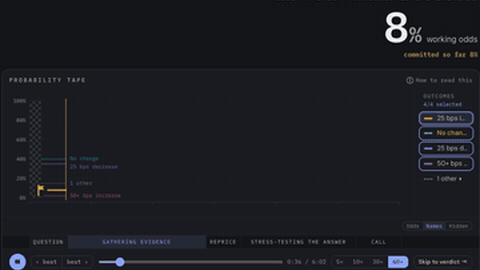

# Prophet Arena

Prophet Arena is "A Live Benchmark for Predictive Intelligence" in which forecasts are made before events resolve.

*Screen recording of Prophet Arena's forecast-trace replay viewer at 60x playback: gemini-3.1-pro's odds on "25 bps increase" for the RBNZ October decision move from 8% to a final 53% as search and reprice steps land over its 6:02 run (replay clock bottom right). Source: [Prophet Arena](https://www.prophetarena.co/f/1p2TIjkOVlqwNWVYsDeCJg#watch).*

| | |
|---|---|
| Year | Oct 2025 |
| Links | [arXiv 2510.17638](https://arxiv.org/abs/2510.17638) |
| Demo | [Prophet Arena](https://www.prophetarena.co/): live leaderboard on real prediction markets plus a [forecast-trace replay viewer](https://www.prophetarena.co/f/1p2TIjkOVlqwNWVYsDeCJg#watch) for recorded agent research runs (timestamped search/reprice steps, 5-60x playback). Paid, logged-in users can watch a run live. Human-playable: no (you can pose a question but not forecast yourself as a player). |
| Play mode | paused-live (forecast before resolution) |
| Clock | questions resolve days to months later |
| Does model latency matter? | No |
| Basis | papers: Prophet Arena §2 "A Live Benchmark for Predictive Intelligence" with event resolution |

## Details

- The live arenas are slow-cadence, noisy and unrepeatable; they are a poor fit for first environments.

## Demo

- [leaderboard] [Prophet Arena homepage](https://www.prophetarena.co/) — Loaded the homepage, the event page for "How many US aircraft carriers in CENTCOM on November 30?" and the /ask page, without logging in or starting a paid run. The homepage shows an "AI consensus of 17 forecasters" dot plot (47%) and a leaderboard with Claude Opus 5.5 / OpenCode at #1, then GPT-6 Astra, Kimi K3.1 Pro and Gemini 4 Argon; the event page compares market midpoint with AI consensus per outcome (for example 62.0% vs 41.2%); /ask lets a logged-in user pay for a run (Light ~$0.58 / Mid ~$1.20 / Deep ~$1.80; "Light ... ~1-2 min, Deep ~5-8 min") and watch it live. Play-mode evidence: not a game and no environment clock; forecasts are "sealed the moment it arrives" and Brier-scored when the event resolves days or weeks later, and the XHRs fetch stored data (api.prophetarena.co/api/market-prices/...). The live-run feature needs login and payment and was not tested.
- [replay-viewer] [forecast trace replay](https://www.prophetarena.co/f/1p2TIjkOVlqwNWVYsDeCJg#watch) — Watched the shared trace of gemini-3.1-pro on "Reserve Bank of New Zealand decision in October?" at 10x (0:55/6:02) and 60x (to 5:39 and 6:02), then clicked 'Skip to verdict' and captured the replay JSON. It shows a probability tape of the model's odds per outcome beside a story feed of framing, search, finding, reprice, stress test and final-call steps, each timestamped (FRAMING 0:12, REPRICE 1:16, FINAL CALL 6:02); the final call is 25 bps increase at 53%, moved from 8%. Play-mode evidence (recorded replay): the page loads /api/shared-forecast/1p2TIjkOVlqwNWVYsDeCJg/replay (76 KB JSON), an event log with wall-clock timestamps (run_start 2026-10-15T21:46:38Z, framing 21:46:49Z) and seq numbers; the UI reads "RAN 6:02" and "replay ready", the odds are "frozen as of the date above", and nothing in the market ticks while the model thinks. The JSON source notes say "Mocked research synthesis".

Visited 10 November 2026 in a headless browser.

Related: [ForecastBench](forecastbench.md)
