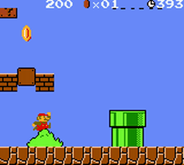

# PyBoy

PyBoy is a Game Boy emulator with a `tick()` API and adjustable emulation speed.

*Recording of the PyBrosAI agent playing a Game Boy Mario level in PyBoy, with the in-game timer at top right; a 5 s excerpt of the README's looping GIF. Source: [Baekalfen/PyBoy README](https://github.com/Baekalfen/PyBoy).*

| | |
|---|---|
| Year | Jan 2016 |
| Demo | [GitHub README media](https://github.com/Baekalfen/PyBoy) (looping GIFs: Pokemon, Mario rewind, Pokemon Pinball AI, PyBrosAI Mario) and the linked third-party video [Training AI to Play Pokemon with Reinforcement Learning](https://www.youtube.com/watch?v=DcYLT37ImBY) (Peter Whidden, PokemonRedExperiments): recordings of games and RL agents running in PyBoy. No LLM play, no replay viewer, not playable in the browser. |
| Play mode | paused-live (Dino browser is realtime-live) |
| Clock | STEP at about 30 fps |
| Observation | numeric state or pixels |
| Action | 1-few buttons |
| Players | 1 |
| Horizon | seconds |
| Human reference | easy |
| Open source | MIT |
| Convertible to realtime-live | high |
| Basis | PyBoy README `tick()` / `set_emulation_speed` |

## Details

- **Flappy Bird**, **PLE**, **MinAtar**, **PyBoy**: tiny, text-serialisable state, one or two buttons. Ideal for latency-versus-score curves. Riemer et al. ([arXiv 2412.14355](https://arxiv.org/abs/2412.14355)) already ran realtime Game Boy Pokemon and Tetris for RL.
- VideoGameBench uses PyBoy as an emulator; the ClaudePlaysPokemonStarter ticks PyBoy only in button handlers.

## Demo

- [project-page-gifs] [Baekalfen/PyBoy README](https://github.com/Baekalfen/PyBoy) — rendered the README (repo has no homepage field). It has a "PyBoy 10th Anniversary" banner and a media grid of looping GIFs captioned "Train RL agents to play Pokemon Red", "Rewind any game" (Super Mario Land, "WORLD 1-1"), "Play the classics" (Pokemon overworld), "Create your own AI" (Pokemon Pinball, links NicoleFaye/PokemonPinballRL) and "Teach Mario to win" (links Baekalfen/PyBrosAI). Files: extras/README/5.gif, 1.gif, pinball.gif, pybrosai.gif. The README also gives a performance table ("x625 realtime" full rendering, "x970 realtime" frame-skip 25, "x1014 realtime" no rendering). Play-mode evidence: recordings only, with no clock or step readouts. The speed-up figures show that the emulator advances only when `tick()` is called and is not tied to wall-clock time.
- [official-video, third-party] [Training AI to Play Pokemon with Reinforcement Learning](https://www.youtube.com/watch?v=DcYLT37ImBY) — linked from the README's "AI Plays Pokemon For 50k Hours" thumbnail. The video is by Peter Whidden, not the PyBoy team, and runs 2032 s. Played it muted and moved to 10 s, 40 s and 90 s. It shows a grid of many parallel Pokemon Red emulator instances driven by an RL agent (battle screens, e.g. "Enemy WEEDLE", "used WATER GUN!"). Play-mode evidence: an edited recording of RL training. There is no LLM, and the video does not show an agent acting against a running clock.

Visited 10 November 2026 in a headless browser.

Related: [VideoGameBench / Lite](videogamebench.md); [Pokemon stream harnesses](pokemon-stream-harnesses.md); [Flappy Bird](flappy-bird.md)
