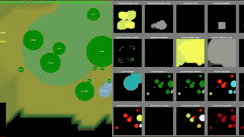

# PySC2 / python-sc2

PySC2 and python-sc2 are StarCraft II interfaces whose `realtime=True` mode advances at 22.4 game loops per second and skips loops the agent misses.

*Recording of the PySC2 renderer showing a simplified Protoss base and minimap (left) beside live feature layers (right); environment footage only, no agent shown, 6 s excerpt at original speed. Source: [Google DeepMind, PySC2 announcement video](https://www.youtube.com/watch?v=-fKUyT14G-8).*

| | |
|---|---|
| Year | 2017 |
| Links | [source](https://github.com/google-deepmind/pysc2/blob/master/docs/environment.md), [python-sc2](https://github.com/BurnySc2/python-sc2) |
| Demo | [video](https://www.youtube.com/watch?v=-fKUyT14G-8): 15-second DeepMind clip, 2017, of the PySC2 renderer with feature layers and a Frame/FPS counter. Hotkey hints suggest the human UI. No agent shown. PySC2 is synchronous by default. Human-playable: no (not in browser). |
| Play mode | paused-live + realtime-live (`realtime=True`) |
| Clock | 22.4 game loops/s, skips missed loops |
| Observation | feature layers, RGB, raw units |
| Action | function calls / unit commands |
| Players | 1 vs AI, 1v1 |
| Horizon | mini-games about 2 min |
| Human reference | easy mini-games |
| Open source | Apache/MIT + Blizzard licence |
| Convertible to realtime-live | native flag |
| Basis | code: pysc2 `pysc2/env/sc2_env.py` (realtime=False default; realtime "automatically advances (at 22.4 gameloops per second)"); python-sc2 `sc2/main.py` (`if not realtime: await client.step()`; `realtime` is a required argument) |

## Details

- [PySC2 docs](https://github.com/google-deepmind/pysc2/blob/master/docs/environment.md); [python-sc2](https://github.com/BurnySc2/python-sc2).
- Verified in source: `realtime=True` advances at 22.4 game loops per second, skips loops the agent misses, and (PySC2) records observation-to-action delays. Default mode is paused with `step_mul`.
- Mini-games (MoveToBeacon, CollectMineralShards, DefeatRoaches and others, listed in `pysc2/maps/mini_games.py`) are single-agent, about two minutes, and easy for novices.

## Demo

- [video] [DeepMind open source PySC2 toolset for Starcraft II](https://www.youtube.com/watch?v=-fKUyT14G-8) — Watched frames at about 5, 10 and 15 s of the 15 s Google DeepMind clip (Aug 2017). Frames show the PySC2 renderer: a simplified Protoss base (Pylons, Gateways, Zealots, Cybernetics Core) with minimap on the left and feature layers on the right (height_map, visibility, player_relative, unit_type, hit_points, shields, unit_density), and a HUD with Minerals, Vespene, Food, Score, Frame and FPS plus hotkey hints 'escape - Cancel' and 'y - Rally'. Play-mode evidence (recording): the Frame/FPS counter shows game-loop steps advancing; the hotkey hints suggest the human-playable pysc2 UI rather than an agent, and nothing shows a model acting.

Visited 10 November 2026 in a headless browser.

## Fit

realtime via a flag; verifiable; single-agent mini-games; needs the Blizzard binary.

Related: StarCraft II family: [TextStarCraft II](textstarcraft-ii.md), [LLM-PySC2](llm-pysc2.md), [AVA / AVACraft](ava-avacraft.md), [SMAC / SMACv2](smac.md), [RTSGameBench](rtsgamebench.md), [DSGBench](dsgbench.md), [Orak](orak.md); [AlphaStar](../solutions/alphastar.md); [SwarmBrain](../solutions/swarmbrain.md); [HIMA](../solutions/hima.md)
