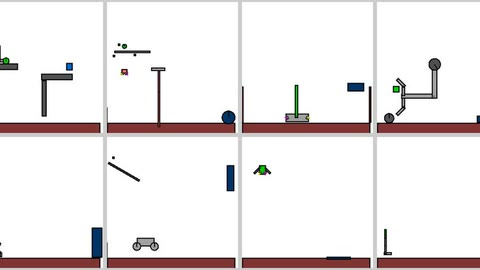

# Real-Time Chunking Kinetix benchmark

The Real-Time Chunking benchmark is "a new benchmark of 12 highly dynamic tasks in the Kinetix simulator" with injected delay, plus 6 real bimanual tasks.

*Still renders of eight of the 12 Kinetix levels used in the benchmark (car launch, catcher, cartpole thrust, grasp, half cheetah, trampoline, lunar lander, walker), tiled into a grid from the paper's Figure 5 level images. Source: [Black, Galliker and Levine, arXiv 2506.07339](https://arxiv.org/html/2506.07339v2).*

| | |
|---|---|
| Year | Jun 2025 |
| Links | [arXiv 2506.07339](https://arxiv.org/abs/2506.07339) |
| Demo | [RTC page](https://www.pi.website/research/real_time_chunking): recorded real-robot videos with latency labels ('~200ms/~300ms latency'), an animated diagram of the robot executing one action chunk while the next is computed, a latency table (139 ms mobile, 108 ms static) and throughput charts at +0/+100/+200 ms injected delay. No Kinetix demo, no interactive or live demo; human-playable: no. |
| Play mode | realtime-live (simulated delay) + realtime-live (real robot) |
| Clock | delay of 0-4 controller steps injected in sim |
| Basis | paper §5: "a new benchmark of 12 highly dynamic tasks in the Kinetix simulator, as well as ... 6 challenging real-world bimanual manipulation tasks" |

## Demo

- [video] [Real-Time Chunking page](https://pi.website/research/real_time_chunking) — Loaded the page (redirects to www.pi.website), read the text and seeked the 2:17 sizzle.mp4 (a robot lighting a candle on a pie); recorded real-robot videos only, no live demo. It shows side-by-side temporal-ensembling failure clips labelled "~200ms latency" and "~300ms latency" (shirt folding), an animated "Thinking while moving" diagram of the previous chunk (green) executing while the next (red) is generated, a latency table (model 97 ms, network 21 ms, total 139 ms mobile and 108 ms static), and throughput and cumulative-progress charts for RTC vs synchronous execution at +0, +100 and +200 ms injected delay. Play-mode evidence: the robot keeps executing the old 50-action (1 s) chunk while the new one is inpainted; the text reports RTC handles more than 300 ms of inference delay and that synchronous inference pauses between chunks. An update dated Dec 8, 2025 links the training-time RTC follow-up used in the pi*0.6 espresso demo.

Visited 10 November 2026 in a headless browser.

Related: [Real-Time Chunking](../solutions/real-time-chunking.md); [Training-time RTC](../solutions/training-time-rtc.md); [A2C2](../solutions/a2c2.md)
