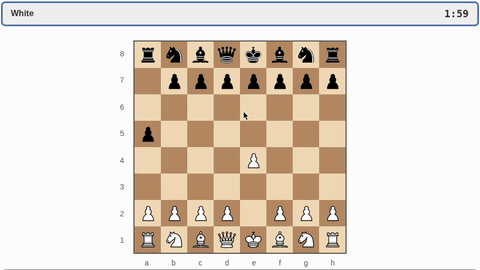

# Realtime-Bench

Realtime-Bench is a benchmark of 50 web and game tasks, each with a programmatic success check, run under wall, token and paused clocks.

*A recording of GPT-6-Astra (high effort) playing White in Realtime-Bench's Timed Chess in wall-clock mode, sped up 11x: its queen raids Black's pieces while its 2:00 clock runs down to 0:39 (this run scored reward 1.0). Source: [Trial recording from the Realtime-Bench Harbor trajectory browser (realtimeagents.org/harbor)](https://realtimeagents.org/harbor/).*

| | |
|---|---|
| Year | 2026 |
| Authors / org | Tang, Yang, Zhang, Wang, Cheng, Zhao, M. Li, W. Li, Xia, Pei (UT Austin, Ohio State, UIUC, NVIDIA, Northwestern, Steadyworks) |
| Links | [arXiv 2610.22155](https://arxiv.org/abs/2610.22155), code [RealtimeAgents/Realtime-Bench](https://github.com/RealtimeAgents/Realtime-Bench) (MIT) |
| Demo | [project site](https://realtimeagents.org/) with one MP4 clip per public task, a [leaderboard](https://realtimeagents.org/#/leaderboard) and a public [trajectory browser](https://realtimeagents.org/harbor/) of every evaluation job (screen recordings plus full per-step trajectories with tick numbers, reasoning, actions and timestamps). Some game tasks have a human-playable view (e.g. [Gomoku, "Play Black"](https://realtimeagents.org/harbor/?view=task&task=gomoku)). Recordings confirm wall-clock play. |
| Play mode | realtime-live + realtime-live + paused-live |
| Clock | WALL, TOKEN (64 tok = 1 s), paused |
| Observation | screenshots 1 FPS + SoM |
| Action | GUI mouse/keyboard |
| Players | 1 |
| Horizon | up to 5 min |
| Human reference | none reported |
| Open source | MIT, 20 of 50 tasks public |
| Convertible to realtime-live | n/a |
| Basis | code: `realtime_framework/clock.py` (`FrameClock`: under token and pause clocks "the world stands still while a model generates"), `docs/evaluation.md:154-155`; paper §3 "Wall Clock advances the environment according to the actual time spent on inference" |
| Play mode (realtime computer use table) | realtime-live (wall, token) + paused-live |
| Clock (realtime computer use table) | see [Realtime-Bench](realtime-bench.md) |
| Basis (realtime computer use table) | see [Realtime-Bench](realtime-bench.md) |

## Details

- Tang, Yang, Zhang, Wang, Cheng, Zhao, M. Li, W. Li, Xia, Pei (UT Austin, Ohio State, UIUC, NVIDIA, Northwestern, Steadyworks). Paper [arXiv 2610.22155](https://arxiv.org/abs/2610.22155); code [RealtimeAgents/Realtime-Bench](https://github.com/RealtimeAgents/Realtime-Bench) (MIT).
- Tasks: 50 tasks, 30 web and 20 game, each with a programmatic success check. 20 are public (12 web, 8 game); the rest are held out. Public game tasks include timed chess (capture four pieces before a two-minute clock expires), Gomoku with ten seconds per move, Pong (return the ball six times), a 13-second timed route, and "survive 30 seconds on a collapsing highway". Public web tasks are operations workflows whose state changes mid-task (dispatch, seating, shipment regrouping).
- Play modes, per the repo's `docs/evaluation.md`: **wall clock** (default and leaderboard setting; observation, network, inference and action latency all count); **token clock** (time advances by output tokens / `tokens_per_frame`, 64 in the paper, so 64 tokens = 1 simulated second at 1 FPS); **paused clock** (one frame per action, action applies at the observed tick). Token and paused clocks need full provider token usage.
- Observation: screenshot at 1 FPS (768x432) plus a read-only Set-of-Marks list. Action: computer-use schema (click, type, key, drag, wait...). Single agent. Episode ends at the terminal condition or five minutes.
- Scoring: binary success, Pass^3 and Pass@k. No human numbers in the paper or the repo docs; tasks are described as "kept feasible for humans".
- Results (12 models: 7 standard, 3 realtime streaming, 2 decision models): best wall-clock success 44.0% and Pass^3 36% (GPT-6-Astra, high effort). Claude Opus 5 at high effort: 70% paused, 30% token clock, 14% wall clock. Gemini 3.8 Flash: 70% paused, 34% token, 32% wall. GPT-Realtime-2: 12-18% wall. Gemini 3.1 Flash Live: 6-18% wall. More reasoning effort helps when paused and is mixed or negative under a clock. Named failure modes: no temporal awareness, not tracking evolving state, misjudging when to act versus wait.
- Requirements: Linux, uv, Apptainer.
- Shortlist rank 1 (Realtime-Bench public tasks, run as is): MIT, wall/token/paused clocks already implemented, single agent, five-minute cap, programmatic scoring. Use it as the external reference point and add the missing piece: a human baseline under the same wall clock. Weakness: 1 FPS screenshots and a GUI action space make it a test of slow reactions.

## Demo

- [project-page] [Realtime-Bench home page](https://realtimeagents.org/) — Viewed the home page: one short MP4 clip per public task (e.g. task-clips/gomoku.mp4, gh_norman_necromancer.mp4, rt_accessible_trip_dispatch.mp4) next to the task prompt. Task pages link a human-playable view for some games, e.g. Gomoku "Play Black" ([/harbor/?view=task&task=gomoku](https://realtimeagents.org/harbor/?view=task&task=gomoku)). The [leaderboard](https://realtimeagents.org/#/leaderboard) is at #/leaderboard.
- [trajectory-browser] [Harbor job browser](https://realtimeagents.org/harbor/) — A public browser of every evaluation job (model, effort, mean reward, trials, duration, tokens, cost). Mean rewards include GPT-6-Astra high 0.43, low 0.42; Gemini 3.8 Flash high 0.25; GPT-5.6 Sol low 0.18; GPT Realtime 2 low 0.15; Claude Opus 5 low 0.15, high 0.13; Jev (web only) 0.12; Gemini 3.8 Live 0.06; all 150/150 trials (50 tasks x 3). Opened GPT-6-Astra high, wall-clock job "collection-gpt-6-astra-high-wall-runs-1-3", task gh_javascript_pong, run 1: reward 0.00, 44 s, 15 steps, with a 45 s screen recording and the full trajectory (prompt, each observation with tick number and screenshot, the model's reasoning summary and JSON action, with timestamps). Per-task: Gomoku 1.00, Timed Chess 0.67, Pong 0.00, Highway 0.00. Play-mode evidence (recorded trajectory): confirms wall-clock realtime-live play. Successive observations are at game ticks 9, 13, 18, 24 while the model spends +3.3 s, +4.2 s, +5.0 s per step, and the model's own reasoning notes "the ball moved 302 times in about 3 seconds! That calls for some fast actions" before choosing hold_key 0.6 s, then wait 0.5 s.

Visited 10 November 2026 in a headless browser.

## Fit

realtime yes; verifiable yes; single yes; human-easy asserted by the authors but not measured; short yes. This is the closest existing work to the project's benchmarking of current models under a clock (see the [home page](../README.md)), and the three-clock protocol is worth copying. Its gaps are the missing human baseline, the 1 FPS observation rate, and that half the tasks are GUI workflows rather than reflex tasks.

Related: [RealtimeBench](realtimebench.md) (a different paper with a near-identical name); [Supporting evidence that more reasoning hurts under a clock](../solutions/README.md#supporting-evidence-that-more-reasoning-hurts-under-a-clock); [gpt-realtime-2](../solutions/gpt-realtime-2.md); [Gemini Live](../solutions/gemini-live.md)
