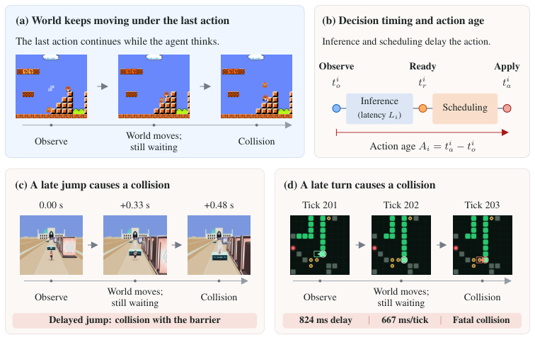

# RealtimeBench (TORSI)

RealtimeBench ("The World Won't Wait") is a set of 180 tasks over six arcade games run paused, live and accelerated, introduced with the TORSI method.

*Paper figure: while the model is still thinking, the game keeps running and the late action causes a crash in Mario, Temple and Snake (an 824 ms delay against a 667 ms tick). Source: [Figure 1 from Pan, Li, Shen, Ding, Tang and Zhang, "The World Won't Wait" (arXiv 2610.20665)](https://arxiv.org/abs/2610.20665).*

| | |
|---|---|
| Year | 2026 |
| Authors / org | Pan, H. Li, Shen, Ding, Tang, W. Zhang (Peking University, Samsung Research Beijing) |
| Links | [arXiv 2610.20665](https://arxiv.org/abs/2610.20665) |
| Demo | None found (searched: arXiv [abs](https://arxiv.org/abs/2610.20665) and HTML for project, code and video links; [Hugging Face papers page](https://huggingface.co/papers/2610.20665), which returns 404; [papers.cool](https://papers.cool/arxiv/2610.20665); and web searches for 'The World Won't Wait', RealtimeBench and TORSI). The paper only has static Figure 1 frame strips showing live-clock failures, such as Snake's 824 ms response against a 667 ms tick. It mentions released replay logs but gives no URL. Human-playable: no. |
| Play mode | realtime-live + paused-live |
| Clock | WALL at 1x, 1.5x, 2x; paused |
| Observation | structured text |
| Action | legal actions, some short plans |
| Players | 1 |
| Horizon | short arcade episodes |
| Human reference | none |
| Open source | no code yet |
| Convertible to realtime-live | n/a |
| Basis | paper §1: "While a response is pending, the game keeps running with the previous control still active"; §4 Paused "freezes the game during inference"; no code released |

## Details

- Pan, H. Li, Shen, Ding, Tang, W. Zhang (Peking University, Samsung Research Beijing). [arXiv 2610.20665](https://arxiv.org/abs/2610.20665). No code URL yet. A different paper from [Realtime-Bench](realtime-bench.md).
- Tasks: 180 tasks, six games x 30: Mario (platforming), Snake, Tetris, Temple (endless runner), River (steer and shoot), Bird (Flappy-style). Built on third-party open-source game implementations.
- Play modes: **paused**; **live** (game keeps running during inference, previous control stays active); **accelerated** (1.5x and 2x pacing). Each game declares its pacing, for example Mario 10 FPS, Snake 1.5 moves/s, Bird 20 FPS, River 60 FPS. It separates response latency (response time minus observation time) from action age (applied time minus observation time).
- Observation: structured text state built by the harness. Action: a legal action per game; several are short open-loop plans (Mario button plans, Tetris rotation + column, Bird one of eight flap schedules), so this is easier than pixels plus key presses.
- Scoring: progress normalised to 0-100 against a reference target per game; mean over six games. No human reference.
- Results (live average): GPT-6.1-sol 1.51 at about 19 s latency, against about 43.9 paused (the paused average was computed from the per-game table, not printed). Jev 13.51 at 0.52 s latency (about 28.3 paused), falling to 10.89 at 1.5x and 6.62 at 2x. StartLux 27B 16.62 was the best live score. So the ranking flips between paused and live.

## Demo

- [project-page] [arXiv abstract and HTML](https://arxiv.org/abs/2610.20665) — Opened the abstract page and the HTML version (2610.20665v1) and searched the text and all links for a repo, project page, video or demo; none exists, and the only GitHub/HF links are third-party game engines and model checkpoints (gym-super-mario-bros, nes-py, SimpleNES, jev-snake, jev-tetris, JevBird, river-run-typesafe, three.js). The paper says "The release includes task definitions, per-episode outcomes, frozen agent specifications, reusable guidance, and replay logs" but gives no URL. Play-mode evidence (static paper figures, rendered from recorded replay logs): Figure 1 shows the game running during inference, with Mario hitting an enemy while the response is pending, a Temple jump colliding at 0.00/+0.33/+0.48 s, and a Snake turn failing at ticks 201 to 203 because the 824 ms response exceeds the 667 ms tick; Table 7 gives clock rates (Mario 10 FPS, Snake 1.5 moves/s, Tetris 450-200 ms per row, River 60 FPS).
- [project-page] [papers.cool entry](https://papers.cool/arxiv/2610.20665) — Opened it; it is an abstract aggregator with PDF and Kimi links only, no media and no code or demo link. No play-mode evidence.
- [dead-or-unreachable] [Hugging Face papers page](https://huggingface.co/papers/2610.20665) — Returns 404 "Paper not found"; no HF model, dataset or Space cites the paper.

Visited 10 November 2026 in a headless browser.

## Fit

realtime yes; verifiable yes; single yes; human-easy in principle; short yes. Not usable until code is released.

Related: [TORSI](../solutions/torsi.md) (the method from the same paper); [Realtime-Bench](realtime-bench.md)
