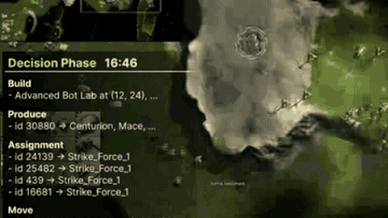

# RTSGameBench

RTSGameBench is a Beyond All Reason benchmark in which the game pauses between decision steps, one call per 15-60 s of game time.

*Recording of a 2v2 match on Pinewood Derby v1 from the authors' overview video (played 3x sped up, cropped to the left part), with the overlay listing the VLM's build, produce, assign and move commands at game time 16:46. Source: [RTSGameBench project page](https://dcahn12.github.io/projects/rtsbench/).*

| | |
|---|---|
| Year | Jun 2026 |
| Authors / org | Kim et al., SNU |
| Links | [arXiv 2606.18950](https://arxiv.org/abs/2606.18950) |
| Demo | [project page](https://dcahn12.github.io/projects/rtsbench/): pre-recorded overview video of Beyond All Reason matches, sped up 3x, with a 'Decision Phase' overlay of the VLM's build, produce, assign and move commands. The in-game console shows 'Battle Resumed', which fits a game that pauses for each decision. Also a static leaderboard of 11 VLMs. Human-playable: no. |
| Play mode | paused-live |
| Clock | fixed 15-60 s of game time per call |
| Observation | minimap + views + text |
| Action | unit orders |
| Players | 1 vs AI |
| Horizon | 10-30 min; mini-games shorter |
| Human reference | yes (mini-games) |
| Open source | no public code (repo not found) |
| Convertible to realtime-live | plausible |
| Basis | paper §3: "The game runs for a fixed interval between decisions and pauses during inference"; App. F.3 Algorithm 1 "Pause the game and read the engine state" |

## Details

- RTSGameBench (Kim et al., SNU, [arXiv 2606.18950](https://arxiv.org/abs/2606.18950)): Beyond All Reason; the game pauses between decision steps, one call per 15-60 s of game time. Human references on mini-games.
- Convertibility: the open Recoil engine behind Beyond All Reason is natively realtime. Units keep executing orders, so degradation under a clock is gradual for macro play and sharp for micro.

## Demo

- [video] [RTSGameBench project page](https://dcahn12.github.io/projects/rtsbench/) — Loaded the page, captured frames from the 75.6 s overview video (rtsbench_vid.mp4) at 11 timestamps and from the 122.7 s self-evolving framework video (self-evol_v2.mp4), and clicked the "Diagnostic Games" leaderboard toggle; the "Code (Coming Soon)" link points back to the page and github.com/snumprlab/RTSGameBench returned 404. The static leaderboard covers 11 VLMs in 1v1, 2v2, 3v3, 3v4 and 1v1v1v1 (Gemini-3-Flash first); the overview has edited Beyond All Reason clips of full games and mini-games (TCP, MFD, FS-F, FS-T, SP) with a "Decision Phase" panel of Build, Produce, Assignment and Move commands; the second video is a slide explainer with no gameplay. Play-mode evidence (recording): clips are marked "3x speedup", the Decision Phase overlay carries game-clock stamps (16:46 in the 2v2 clip on Pinewood Derby v1, 11:43 in the 3v4 clip on Wanderlust 2.1), and the 2v2 console reads "Battle Resumed", which fits a game paused during each decision. No latency figures, replay viewer or human play.

Visited 10 November 2026 in a headless browser.

Related: StarCraft II family: [TextStarCraft II](textstarcraft-ii.md), [LLM-PySC2](llm-pysc2.md), [AVA / AVACraft](ava-avacraft.md), [SMAC / SMACv2](smac.md)
