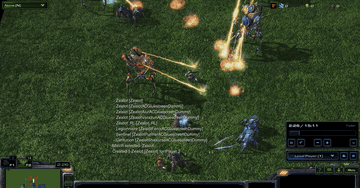

# SMAC / SMACv2

SMAC and SMACv2 are step-locked StarCraft II multi-agent micro battles.

*Recording of a StarCraft II replay of trained MARL policies in the SMACv2 protoss 20 vs 20 scenario, with the replay clock (in-game time, about 2:26 to 2:30) at right; the bottom UI panel is cropped out. Source: [SMACv2 authors, "protoss 20 vs 20" video](https://www.youtube.com/watch?v=GOutN3hWAcc).*

| | |
|---|---|
| Year | Feb 2019 |
| Links | [repo](https://github.com/oxwhirl/smacv2) |
| Demo | [SMACv2 project page](https://sites.google.com/view/smacv2): nine embedded YouTube videos (terran, protoss, zerg at 5 vs 5, 10 vs 11, 20 vs 20) of trained MARL policies, recorded as StarCraft II replays played back in the game client. Recordings only, not live and not human-playable. |
| Play mode | paused-live |
| Clock | STEP |
| Observation | unit features |
| Action | per-unit discrete |
| Players | multi-agent |
| Horizon | under 2 min |
| Human reference | n/a |
| Open source | MIT |
| Convertible to realtime-live | via SC2 realtime |
| Basis | code: `smacv2/env/starcraft2/starcraft2.py` (realtime=False, `_controller.step(step_mul)`, step_mul 8) |

## Details

- Convertibility (StarCraft II family): SC2 has a verified `realtime=True`; SMAC-style micro battles are under two minutes with objective outcomes. Units keep executing orders, so degradation under a clock is gradual for macro play and sharp for micro.

## Demo

- [project page with videos] [SMACv2 project page](https://sites.google.com/view/smacv2) (linked from the smacv2 README: "Videos of learned policies are available on our website") — Rendered the page and listed its media: abstract, training-curve images and nine YouTube embeds introduced as "Below are videos of trained agents in a range of SMACv2 scenarios", titled "terran 5 vs 5", "terran 10 vs 11", "terran 20 vs 20", "protoss 5 vs 5", "protoss 10 vs 11", "protoss 20 vs 20", "zerg 5 vs 5", "zerg 10 vs 11", "zerg 20 vs 20" (unlisted, uploaded by Ben Ellis). The embeds failed in headless Chrome (YouTube "Error 153"), so I opened the watch pages and played two of them, seeking each to about 60%.
- [official video] [terran 5 vs 5](https://www.youtube.com/watch?v=5mUqtGir4e0) — 58 s video. At 0:37 it shows the StarCraft II replay UI with a replay clock "0:36 / 9:18" at speed "Faster", a small terran squad on open grass, and a minimap. [protoss 20 vs 20](https://www.youtube.com/watch?v=GOutN3hWAcc) — 67 s video. At 0:42 the replay clock reads "2:29 / 15:11" and shows zealots fighting, with debug text from the map's unit spawning ("Match selected: Zealot", "Created 1 Zealot [Zealot] for Player 2"). Play-mode evidence (recording): these are .SC2Replay playbacks of episodes from trained RL policies (the page's results section names MAPPO and QMIX). The replay clock is in-game time, so the videos say nothing about wall-clock decision latency. That fits a step-locked environment. No LLM agent appears.

Visited 10 November 2026 in a headless browser.

Related: [PySC2 / python-sc2](pysc2-python-sc2.md); [AVA / AVACraft](ava-avacraft.md); [TextStarCraft II](textstarcraft-ii.md); [LLM-PySC2](llm-pysc2.md); [RTSGameBench](rtsgamebench.md)
