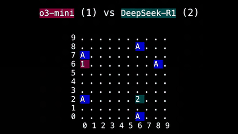

# SnakeBench

SnakeBench is a model-versus-model Snake arena where "The simulation proceeds round-by-round".

*Recorded replay of a turn-based o3-mini vs DeepSeek-R1 SnakeBench match (snakes "1"/"2" with tails "T", apples "A"), sped up 5x from the original animation. Source: [ARC Prize Foundation, SnakeBench blog](https://arcprize.org/blog/snakebench).*

| | |
|---|---|
| Year | 2024-26 |
| Links | [repo](https://github.com/gkamradt/SnakeBench) |
| Demo | [snakebench.com](https://snakebench.com/) ([top match replay](https://snakebench.com/match/10f42d75-5678-4626-9678-12bfd8f98fb6)) (+ [ARC Prize blog](https://arcprize.org/blog/snakebench)): leaderboard and replay viewer for recorded LLM-vs-LLM snake matches. You step round by round (Round N/100) and see each model's move and rationale. The game is turn-based and waits for both models' moves each round, with no clock. A [Live Games page](https://snakebench.com/live-games) polls for matches in progress but showed none when visited. Human-playable: no. |
| Play mode | paused-live, turn-based |
| Clock | none or generous per-move limits |
| Observation | text / board |
| Action | moves |
| Players | 1-2+ |
| Horizon | long |
| Human reference | varies |
| Open source | varies |
| Convertible to realtime-live | not meaningful |
| Basis | SnakeBench README "proceeds round-by-round" |

## Details

- In the turn-based or untimed contrast set: SnakeBench ([repo](https://github.com/gkamradt/SnakeBench): "The simulation proceeds round-by-round"). None of the contrast set has a native clock; a deadline could be imposed but the games do not reward reflexes. They are useful as the "same model, no clock" control.

## Demo

- [replay-viewer] [SnakeBench top match replay](https://snakebench.com/match/10f42d75-5678-4626-9678-12bfd8f98fb6) — Opened the Top Match and a recent match, let it autoplay about 5 s (Round 10 to Round 20), then used Pause, End (Round 100 / 100), Start and Next to step round by round; inspected page HTML and network. A 10x10 board with two LLM snakes and apples, each model's move and text rationale in side panels, a 'Round N / 100' counter, transport and speed controls (0.5x/1x/2x), a 'Thoughts: Current/Next' toggle and 'Download MP4'. Top match: ByteDance Seed-2.0-Mini 32 vs Qwen3 VL 235B A22B Thinking 26 (February 28, 2026). Play-mode evidence (recorded replay): the whole match is server-rendered as a 'frames' array (state plus per-snake move, rationale, input_tokens, output_tokens, cost) with no latency or timestamp fields; replay speed is a viewer setting.
- [leaderboard] [SnakeBench leaderboard](https://snakebench.com/) — Read the TrueSkill leaderboard (3,462 games, 845 models, $1449.11 cost; columns rating, uncertainty, W/L, win%, apples, best, cost; OpenAI GPT-5.1-Codex-Max #1 at visit), with per-model pages, Latest Games (95 matches with replay links) and an About page describing the prompt and methodology. Static results linking to recorded replays.
- [replay-viewer] [SnakeBench Live Games](https://snakebench.com/live-games) — Opened it and watched network traffic: 'No games currently in progress. Check back soon to watch live battles! Auto-refreshing every 2 seconds...', polling /api/games/live. No live game could be watched; live games would use the same turn-based setup.
- [project-page] [ARC Prize SnakeBench blog](https://arcprize.org/blog/snakebench) — Read the ARC Prize Foundation write-up (about 2.8K head-to-head games, Elo rankings, a GIF of a recorded o3-mini vs DeepSeek match, prompt format, findings). Play-mode evidence (text): 'Each LLM was prompted for its move in each round. Moves were applied simultaneously.' The post calls it 'real-time decision-making', but the mechanics wait for the models with no clock.

Visited 10 November 2026 in a headless browser.