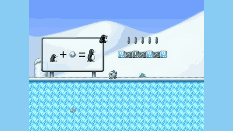

# SpeedrunBench

SpeedrunBench "scores LLM agents on the number of frames needed to reach a goal state", with a scripted offline mode and a paused-live online mode.

*A recording of GPT-5.6 Sol's SpeedrunBench run through SuperTux level 1-1 "Welcome to Antarctica" (finished in 0:33.047), with Tux running and jumping past enemies. Source: [Footage: SpeedrunBench (Fujinuma, Kamahori, Koike et al.; Patronus AI), speedrunbench.com play page; game: SuperTux.](https://speedrunbench.com/play).*

| | |
|---|---|
| Year | 2026 |
| Authors / org | Fujinuma, Kamahori, Koike and others (Patronus AI, UW, Institute of Science Tokyo) |
| Links | [arXiv 2610.08076](https://arxiv.org/abs/2610.08076), [site](https://speedrunbench.com), [repo](https://github.com/patronus-ai/speedrun_bench); patched games [supertux-speedrun](https://github.com/patronus-ai/supertux-speedrun) and [tuxemon-speedrun](https://github.com/patronus-ai/tuxemon-speedrun); gated dataset on [Hugging Face](https://huggingface.co/datasets/PatronusAI/speedrunbench) |
| Demo | [play page](https://speedrunbench.com/play): a human plays SuperTux live in the browser against a pre-recorded agent run (MP4) with a fixed target time; [leaderboard](https://speedrunbench.com/leaderboard) ranks models by best completion time. The agent side is a replay, not a model running live. Human-playable: yes. |
| Play mode | scripted (offline) + paused-live (online; from the paper's definition, online harness not public) |
| Clock | deterministic, one frame per action; score = frames to goal |
| Observation | frames |
| Action | input trace / actions |
| Players | 1 |
| Horizon | 1 level to hours |
| Human reference | world records |
| Open source | offline harness and patched games open |
| Convertible to realtime-live | yes for SuperTux, SuperTuxKart |
| Basis | offline: README "The agent never runs the game"; online: paper §3.2 "each action advances the game by one frame" + frame-tape seed `seeds/supertux/welcome_seed_9498f.json` + tuxemon-speedrun `tools/tux_env.py` (fixed ticks per `step()`); online runner not published |

## Details

- SpeedrunBench (Oct 2026).
- Fujinuma, Kamahori, Koike and others (Patronus AI, UW, Institute of Science Tokyo). [arXiv 2610.08076](https://arxiv.org/abs/2610.08076); site [speedrunbench.com](https://speedrunbench.com); [repo](https://github.com/patronus-ai/speedrun_bench); patched games [supertux-speedrun](https://github.com/patronus-ai/supertux-speedrun) and [tuxemon-speedrun](https://github.com/patronus-ai/tuxemon-speedrun); gated dataset of tapes and videos on [Hugging Face](https://huggingface.co/datasets/PatronusAI/speedrunbench).
- Games: Super Mario Bros., Super Mario Land, Mario Kart 64, Pokemon Blue/Red, Civilization I, Astray, SuperTux, Tuxemon, SuperTuxKart (the site says 10 titles and the dataset card also lists Wolfenstein 3D).
- **Offline mode: scripted.** A coding agent (via Opencode) writes a complete frame-indexed input tape each turn; a separate container replays it and returns the outcome and frame count; 200 turns. The README says "The agent never runs the game." Sub-settings: offline-scratch and offline-seed.
- **Online mode: paused-live** (see the online-mode evidence bullets below). The agent sees the current frame and chooses the next action or short sequence; the score is game frames to the goal, not wall-clock time.
- Scoring: frames to goal as a percentage of the human world record (records are human real-time-attack runs).
- Results: offline with a per-turn scorer gets within about 7% of the record on SuperTux and about 3% on Super Mario Land. Online Pokemon Blue to the first badge takes about 4-12 times the record (Opus 5: 160,021 frames against about 40,435).
- Online mode evidence. The online mode is classified paused-live on this evidence:
- Paper, section 3.2: a game is defined as "a deterministic environment" in which "each action advances the game by one frame", and in the online setting, "given a current state of a game, the agent decides the next action". Game time is therefore a function of actions issued, not of elapsed time.
- Score: frames to the goal. The site states it "scores LLM agents on the number of frames needed to reach a goal state". Inference time is not part of the score, and no latency, pause or wall-clock handling is mentioned anywhere in the paper (main text and appendix), the site or the dataset card.
- Code: the open games are driven one logic step at a time. `DETERMINISM.md` in supertux-speedrun describes cancelling the browser main loop (`st_pause_main_loop()`) and having the harness call `st_tick()` once per step after applying that step's inputs, so the harness, not the clock, decides how many steps run.
- The only agent-in-the-loop environment code the authors released, `tools/tux_env.py` in tuxemon-speedrun, advances a fixed number of engine ticks per `step(action, hold=4, frames=8)` call and refuses to start unless `TUXEMON_DETERMINISTIC=1` ("Without it the engine runs on wall-clock").
- The GPT-5.6-sol online run is stored as a frame-indexed tape (`seeds/supertux/welcome_seed_9498f.json`, 257 keyed frames up to frame 9,498). At SuperTux's `LOGICAL_FPS = 64.0` (`src/supertux/constants.hpp:23`) that is 148.4 s of game time, with input changes as little as 16-31 ms apart, which a model running at maximum reasoning effort could only have produced in a game that waited for it.
- Which sentence governs: the introduction says the online agent acts "while the game runs", but the formal definition in §3.2 ("each action advances the game by one frame") is what the scores are computed under, the conclusion restates online as agents that "get frame by frame screen shots and must take an action", and every online result is a frame count (Opus 5 "160,021 frames"). The introduction's phrase contrasts acting within an episode with editing a whole trace; it does not describe a running clock.
- What the sources do not contain: the online harness itself. The public repo (main, seven other branches and PR refs 1-15, history to depth 200) holds only the offline tape loop, scorers and agent cards; `sandbox/Dockerfile`, `.dockerignore` and `scripts/tas_decoding.sh` refer to unpublished files such as `scripts/pokemon_online_calib.py` and `sandbox/ONLINE_SPEEDRUN.md`. The Hugging Face dataset is gated (its public file tree lists only tapes, videos and metadata). So how many frames an online action is held, the emulators used for the commercial titles, and the exact online loop are not documented (the paper says only "the next action or short sequence of actions"). The site (a JavaScript app; its bundle was read) lets humans race recorded model runs and adds no technical detail on online play.
- Convertibility: good for the three open-source games. SuperTux's stock main loop derives its step count from the wall clock (`SDL_GetTicks`), which is the realtime behaviour the benchmark patched out; running without `SUPERTUX_DETERMINISTIC`, or ticking `st_tick()` from a 64 Hz timer and applying the latest action, gives an unpaused online mode. Score would then be wall-clock time to goal, directly comparable to the human real-time records the paper already uses. SuperTux level 1-1 and one SuperTuxKart lap are short, single-player and human-easy. What breaks: bit-exact determinism (the reason for the patch), and at current latencies a platformer at 64 logic steps per second leaves a model hundreds of frames behind per decision, so a slowed clock or action chunks would be needed. The commercial titles would need their own emulators and ROMs.
- Shortlist rank 4: SuperTux 1-1 is part of the small arcade suite on a three-clock wrapper (with Atari, Flappy Bird and V-MAGE games; see [ALE / Atari](ale-atari.md)).

## Demo

- [human-play] [SpeedrunBench play page](https://speedrunbench.com/play) — Accepted the Terms of Use (they record inputs, scores, browser type and IP, and grant a perpetual licence to publish gameplay data) and played SuperTux "Welcome to Antarctica" live; my Tux was stopped by a snowball enemy at 0:12.0. The left pane runs SuperTux in the browser (iframe, /games/supertux/build/) with a human timer counting in real time ("live run"). The right pane is the agent's run as a pre-recorded MP4 (media/imported/supertux/gpt-5.6-sol-1.mp4) with a fixed target time (GPT-5.6 Sol 0:33.047). A dropdown offers 11 models and arrows switch between a model's attempts. Games: SuperTux, Tuxemon, SuperTuxKart. Play-mode evidence: the demo does not run a model live; it replays a recorded run, and the site does not say which mode (offline or online) the runs come from.
- [leaderboard] [SpeedrunBench leaderboard](https://speedrunbench.com/leaderboard) — Read the page. "Fastest run wins": models are ranked by best successful completion time, fastest = 100. SuperTux 1-1: DeepSeek Pro 0:28.813, DeepSeek Flash 0:28.828, GLM 5.3 0:28.828, Kimi 0:29.656, Claude Opus 0:32.234, GPT-5.6 Sol 0:33.047, GLM 5.2 0:34.813, Grok 4.6 0:37.250, Inkling Small 2:17.313, Gemini Flash 3.7 2:22.094, Inkling Full 2:28.406. The 33 s GPT-5.6 Sol run is far shorter than the 148 s online tape in the repo (`seeds/supertux/welcome_seed_9498f.json`), which is consistent with the site's runs being offline (scripted) optimised tapes; this is an inference, not stated on the site.

Visited 10 November 2026 in a headless browser.

Related: [PokeAgent Challenge, speedrunning track](pokeagent-speedrun.md); [Factorio Learning Environment](factorio-learning-environment.md)
