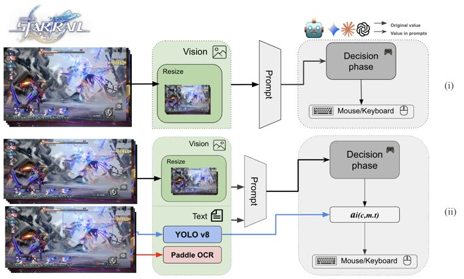

# StarBench

StarBench is "A Turn-Based RPG Benchmark".

*Paper figure (diagram) of the two interaction protocols: (i) direct control, where the VLM maps a resized Honkai: Star Rail combat screenshot to mouse/keyboard actions, and (ii) tool-assisted, where YOLOv8 detections and PaddleOCR text are added to the prompt and the model picks a high-level action. Source: [Zhang, Zhu et al., StarBench, arXiv 2510.18483, Figure 2](https://arxiv.org/html/2510.18483v1).*

| | |
|---|---|
| Year | Oct 2025 |
| Links | [arXiv 2510.18483](https://arxiv.org/abs/2510.18483) |
| Demo | None found (searched: arXiv abstract page (no comments or project link), paper HTML links, GitHub repo search for "StarBench" and "honkai star rail benchmark", web search for StarBench demo, video, project page and Hugging Face Space; the alphaXiv benchmark listing is a score table with no replays) |
| Play mode | paused-live, turn-based |
| Clock | none or generous per-move limits |
| Observation | text / board |
| Action | moves |
| Players | 1-2+ |
| Horizon | long |
| Human reference | varies |
| Open source | varies |
| Convertible to realtime-live | not meaningful |
| Basis | StarBench title "A Turn-Based RPG Benchmark" |

## Details

- In the turn-based or untimed contrast set: StarBench ([arXiv 2510.18483](https://arxiv.org/abs/2510.18483), "A Turn-Based RPG Benchmark"). None of the contrast set has a native clock; a deadline could be imposed but the games do not reward reflexes. They are useful as the "same model, no clock" control.

## Demo

- None found. The arXiv abstract page for "StarBench: A Turn-Based RPG Benchmark for Agentic Multimodal Decision-Making and Information Seeking" (Zhang, Zhu et al., 21 Oct 2025) has no comments field and no project or code link. The paper HTML links only to outside sites (game wikis, PyAutoGUI). A GitHub search found only unrelated repos with the same name. Web searches found no project page, video, Hugging Face Space or replay viewer. The [alphaXiv benchmark listing](https://alphaxiv.org/benchmarks/stanford-university/starbench) only lists scores.

Searched 10 November 2026; no demo found.

Related: [STAR](star.md) (a different benchmark whose script is named `starbench.py`)
