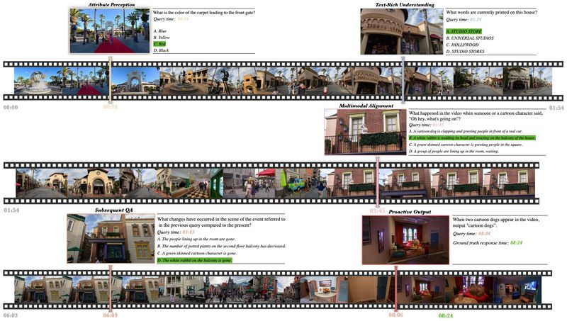

# StreamingBench

StreamingBench is a streaming video understanding benchmark whose questions carry timestamps on recorded video.

*Final frame of the authors' animated overview clip (a diagram, not a model recording): one walking-tour video as a filmstrip with five task types (Attribute Perception, Text-Rich Understanding, Multimodal Alignment, Subsequent QA, Proactive Output) pinned to their query times, correct options highlighted in green. Source: [StreamingBench project page](https://streamingbench.github.io/).*

| | |
|---|---|
| Year | Nov 2024 |
| Links | [arXiv 2411.03628](https://arxiv.org/abs/2411.03628) |
| Demo | [project page](https://streamingbench.github.io/) with a sample video, leaderboard and an embedded [result visualizer](https://sbvisualizer-github-io.vercel.app/) that plays benchmark videos with timestamped questions and the recorded answers of about ten models. Recorded outputs only; no live model and nothing human-playable. |
| Play mode | offline replay |
| Clock | questions carry timestamps on recorded video |
| Basis | paper Table 1: "Timestamp denotes whether to assign timestamps to questions" |

## Details

- None of the streaming video benchmarks has actions; slow inference is not punished unless the metric is timing-aware (PAUC).

## Demo

- [project-page] [StreamingBench project page](https://streamingbench.github.io/) — Rendered it and played the sample clip (`static/images/sv.mp4`, 12.3 s): a filmstrip of a theme-park walk with questions pinned to timestamps, for example "Attribute Perception ... Query time: 00:24" and "Text-Rich Understanding ... Query time: 01:26". The page also has a static leaderboard ("Experiment Setting: 60 seconds of context preceding the query time"; Gemini 1.5 Pro 70.26 overall, MiniCPM-o 2.6 66.01, GPT-4o 64.10) and dataset statistics (900 videos; "Video Games" 43, 4.78%). Play-mode evidence: recorded video with offline QA.
- [replay-viewer] [StreamingBench visualizer](https://sbvisualizer-github-io.vercel.app/) (iframe on the project page) — Played `videos/video1.mp4` (3:08, a La Liga match) and seeked to 0:31. The seek bar has red markers at the query times; the card shows "Question: What logos are visible in the background as players and referees walk towards the center of the football field? Task Type: Object Perception Query Time: 0:04" with options A to D, followed by stored answers from GPT-4o, Claude 3.5 Sonnet, Gemini 1.5 Pro, LLaVA-OneVision, MiniCPM-V 2.6, Qwen2-VL, InternVL-V2, LongVA, Video-CCAM (all "D") and Flash-VStream ("A. FIFA and Premier League."). The filters cover Real-Time Visual, Omni-Source and Contextual Understanding, and the video list includes Proactive Output and Sequential Question Answering. Play-mode evidence (recorded): network traffic showed only static mp4/jpg files and no model API calls; the answers are precomputed and do not change with playback. This matches the offline replay label.

Visited 10 November 2026 in a headless browser.

Related: [Dispider](../solutions/dispider.md) (evaluated on StreamingBench); [OVO-Bench](ovo-bench.md); [OmniMMI](omnimmi.md); [ProactiveVideoQA](proactivevideoqa.md)
