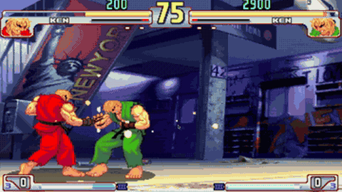

# Win Fast or Lose Slow: StreetFighter

In the StreetFighter benchmark from "Win Fast or Lose Slow", two locally served models fight in Street Fighter III on DIAMBRA and a model that overruns stands still while the game goes on.

*Recording of a model-vs-model Street Fighter III match on DIAMBRA from the authors' FPX speed demo (2.4x clip, red player at 542 ms latency), cropped from a desktop screen capture; the round timer keeps counting down from 75 to 71 while the models think. Source: [competitive-agent.com project page (Kang et al.)](https://www.competitive-agent.com/).*

| | |
|---|---|
| Year | 2025 |
| Authors / org | Kang, Q. Zhang, Cai, Xu, Krishna, Du, Weissman (Georgia Tech, Berkeley, Harvard, Stanford) |
| Links | [arXiv 2505.19481](https://arxiv.org/abs/2505.19481), code [LatencySensitiveBench](https://github.com/HaoKang-Timmy/LatencySensitiveBench) (no licence file) |
| Demo | [project page](https://www.competitive-agent.com/): pre-recorded screen-capture videos of LLM-vs-LLM Street Fighter III matches (DIAMBRA) in which the game's round timer keeps running while the models think, selectable by FPX speedup (1.0x = 1301ms to 2.4x = 542ms latency for the red player); [code](https://github.com/HaoKang-Timmy/LatencySensitiveBench) embeds one more clip. Human-playable: no. |
| Play mode | realtime-live |
| Clock | env loop steps continuously with no-move default (code read) |
| Observation | text state |
| Action | named moves |
| Players | 2 (model vs model) |
| Horizon | 1 round |
| Human reference | none |
| Open source | repo, no licence |
| Convertible to realtime-live | n/a |
| Basis | code: `StreetFighter/GameEngine/Engine/game.py` (main loop `env.step` with action 0 for any player without a pending action) |

## Details

- Win Fast or Lose Slow: StreetFighter (May 2025, NeurIPS 2025).
- Kang, Q. Zhang, Cai, Xu, Krishna, Du, Weissman (Georgia Tech, Berkeley, Harvard, Stanford). [arXiv 2505.19481](https://arxiv.org/abs/2505.19481); code [LatencySensitiveBench](https://github.com/HaoKang-Timmy/LatencySensitiveBench) (no licence file).
- Task: two locally served models fight in Street Fighter III on DIAMBRA. Each action occupies about 200 ms of game time; latency below 200 ms gives no further gain. Text observations, named moves, ELO over 40 matches per pair. Code read (`StreetFighter/GameEngine/Engine/game.py`): the main loop calls `env.step` continuously; any player with no action ready gets action 0 (no move), and actions are cleared after each step. Players run in separate processes and post actions to shared state. So a model that overruns simply stands still while the game goes on. The loop is not paced to a fixed frame rate; it runs as fast as the emulator steps, with a 1 ms sleep.
- Results: Qwen2.5-3B with FPX at 195 ms has the best ELO (5.99), ahead of 7B at 354 ms (2.33) and 1.5B at 142 ms (-1.25).

## Demo

- [video] [competitive-agent.com project page](https://www.competitive-agent.com/) — Loaded the page and clicked each speed button (1.0x, 1.6x, 2.1x, 2.4x) of the StreetFighter "FPX Speed Demonstration" widget, which swaps between 4 pre-recorded .mov clips of about 34-37 s each; seeked the 1.0x and 2.4x clips and captured frames. The clips are macOS desktop screen recordings of Street Fighter III (Ken vs Ken, model vs model, via DIAMBRA), captioned e.g. "1.0x Speed For Red Player / Latency: 1301ms (14B Model)" and "Latency: 542ms" at 2.4x. Play-mode evidence (recording): the round timer counts down on its own (62 at 0:11, 32 at 0:33 in the 1.0x clip; 54 at 0:35 in the 2.4x clip) and scores change (2500 vs 1700, then 3900 vs 6200), so the game does not wait for the model; the network log shows only .mov fetches and no model calls. Not human-playable.
- [project-page] [LatencySensitiveBench repo](https://github.com/HaoKang-Timmy/LatencySensitiveBench) — Read the README. Its Visualization section embeds one more recorded StreetFighter clip (video1_8vsfpx.mp4) and has an HFTBench heading; run instructions use DIAMBRA Arena (`run_api.py --agent1 Qwen/Qwen3-4B --agent2 Qwen/Qwen3-8B`), which needs a DIAMBRA account and the game ROM. Play-mode evidence: only a recorded video plus instructions for running locally; nothing hosted to play or run live.

Visited 10 November 2026 in a headless browser.

## Fit

realtime yes; verifiable (relative); not single player; human-easy yes; short yes. [HFTBench](hftbench.md) from the same paper is under near neighbours.

Related: [HFTBench](hftbench.md); [FPX](../solutions/fpx.md); [DIAMBRA Arena](diambra-arena.md); [LLM Colosseum](llm-colosseum.md)
