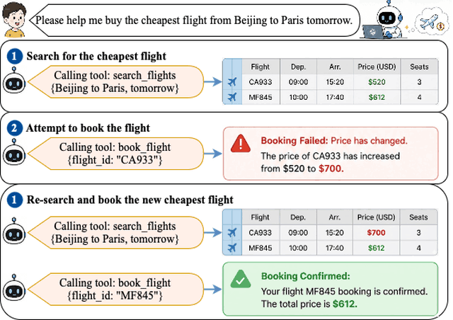

# STT-Arena

STT-Arena is a computer-use benchmark whose triggers fire on state and spatio-temporal conditions, not wall clock.

*Paper figure (Figure 1, a diagram, not a recording): a flight's price rises after the agent searches, so its booking fails and it re-searches and books the new cheapest flight. Source: [STT-Arena paper, arXiv 2605.18548](https://arxiv.org/abs/2605.18548).*

| | |
|---|---|
| Year | 2026 |
| Links | [arXiv 2605.18548](https://arxiv.org/abs/2605.18548) |
| Demo | None found (searched: arXiv abstract page (comment "Work in progress") and HTML paper links, GitHub [Miaow-Lab/STT-Arena](https://github.com/Miaow-Lab/STT-Arena) README (no homepage, only static figures) and repo page, Hugging Face dataset [Miaow-Lab/STT-Arena](https://huggingface.co/datasets/Miaow-Lab/STT-Arena) and Spaces search, web search for "STT-Arena" demo) |
| Play mode | paused-live (state-triggered) |
| Clock | triggers fire on state and spatio-temporal conditions, not wall clock |
| Basis | paper §3: each trigger has "a condition depending on the state and the spatio-temporal context" |

## Demo

- None found. The arXiv abstract has only the comment "Work in progress". The GitHub repo [Miaow-Lab/STT-Arena](https://github.com/Miaow-Lab/STT-Arena) has no homepage field, and its README has only static figures (`assets/method.png`, `assets/benchmark_stats.png`, `assets/overall_bar_vertical.png`), with no videos, GIFs or viewer. The Hugging Face dataset [Miaow-Lab/STT-Arena](https://huggingface.co/datasets/Miaow-Lab/STT-Arena) shows only a raw Data Studio row preview of tool-call SFT trajectories ("The full dataset viewer is not available"), which is a data table, not a replay viewer. Miaow-Lab has no Hugging Face Spaces; the Space `kadirnar/stt-arena` is an unrelated speech-to-text leaderboard.

Searched 10 November 2026; no demo found.
