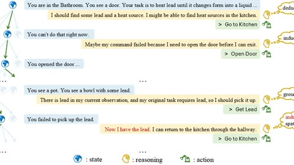

# TALES

TALES is a text-adventure benchmark with text games stepped per action.

*Diagram from the TALES project page of an agent working through a ScienceWorld-style text game one turn at a time: each game state is followed by the model's reasoning, labelled deductive, inductive, grounded or spatial, and then a typed action; the last step shows an inductive and spatial reasoning error. Source: [TALES project page](https://microsoft.github.io/tale-suite/).*

| | |
|---|---|
| Year | Apr 2025 |
| Links | [arXiv 2504.14128](https://arxiv.org/abs/2504.14128) |
| Demo | [site](https://microsoft.github.io/tale-suite/): static leaderboard and per-game score charts, plus an embedded Zork I (iplayif/Parchment) that a human can play; [HF trajectories](https://huggingface.co/datasets/PEARLS-Lab/TALES-Trajectories) holds recorded per-step agent transcripts in a dataset viewer. Turn-based: the game waits for each action, and nothing on the site shows a live model. Human-playable: yes (Zork I only). |
| Play mode | paused-live, turn-based |
| Clock | none or generous per-move limits |
| Observation | text / board |
| Action | moves |
| Players | 1-2+ |
| Horizon | long |
| Human reference | varies |
| Open source | varies |
| Convertible to realtime-live | not meaningful |
| Basis | TALES paper (text games per step) |

## Details

- In the turn-based or untimed contrast set: TALES ([arXiv 2504.14128](https://arxiv.org/abs/2504.14128), text games stepped per action). None of the contrast set has a native clock; a deadline could be imposed but the games do not reward reflexes. They are useful as the "same model, no clock" control.

## Demo

- [leaderboard] [TALES site](https://microsoft.github.io/tale-suite/) — Loaded the page and clicked the Leaderboard, Environments, Scores By Framework and Scores By Game tabs. It is a static leaderboard of 40 LLM rows (o3 (medium) first at 58.7%, claude-3.7-sonnet (reasoning) 52.5%, Phi-3-medium last at 0.7%), framework descriptions (TextWorld, TextWorld Express, ALFWorld, ScienceWorld, Jericho) and score charts as PNG images (for example all_framework_scores.png); no agent replays or trajectory viewer. Play-mode evidence: fixed numbers only and no model calls; the suite steps the game once per action, so there is no real-time clock.
- [playable] [Zork I in iplayif (Parchment)](https://iplayif.com/?story=https%3A%2F%2Fgithub.com%2FBYU-PCCL%2Fz-machine-games%2Fraw%2Frefs%2Fheads%2Fmaster%2Fjericho-game-suite%2Fzork1.z5) — Opened Environments > Jericho on the project page, which embeds this iframe with the caption "Try it yourself! Type commands like look, inventory, or go north"; Play! opened the game in a popup, and I played it live as a human with 7 commands (open mailbox, read leaflet, north, east, open window, enter, look) to reach the Kitchen at Score 10, Moves 7, then left it idle for 10 s. It runs on the Bocfel Z-machine interpreter (bocfel.wasm) with a room/score/moves status bar. Play-mode evidence (played live, human only): the text did not change during 10 idle seconds and the move counter rises only on input, so the game waits; the network log shows only bocfel.js, bocfel.wasm and the zork1.z5 story file, with no model API calls.
- [replay-viewer] [TALES-Trajectories dataset](https://huggingface.co/datasets/PEARLS-Lab/TALES-Trajectories) — Loaded the dataset page and Dataset Viewer, and also the [downsampled set](https://huggingface.co/datasets/talesuite/tale_suite_trajectories_downsampled). It holds recorded agent transcripts as table rows (subsets alfworld 3.78k, jericho 17.1k, scienceworld 9.4k, textworld 3.11k, textworldexpress 5.02k) with columns model, agent_type, total_steps, score, normalized_score, turns (JSON list of environment and agent messages), score_progression (step and score pairs) and thinking tokens; the downsampled set keeps only top-10 model runs (for example claude-3.7-sonnet react runs capped at 100 steps). Play-mode evidence (recorded transcripts): progress is indexed by step number with no wall-clock timestamps, matching turn-based stepping where the game waits for the model.

Visited 10 November 2026 in a headless browser.

Related: [TextWorld](textworld.md); [Jericho](jericho.md)
