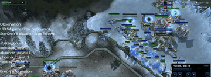

# TextStarCraft II

TextStarCraft II plays StarCraft II through text macro actions against the built-in AI (paused) and in human matches (realtime).

*Recording of the authors' edited demo video: the LLM agent's text observation, then its "LLM Thought" and chosen strategy (Voidray defense), overlaid on its Protoss base under Zerg attack, with the replay clock at bottom right. Source: [Domination from Above, TextStarCraft II authors (YouTube)](https://www.youtube.com/watch?v=Iz6Hd917eME).*

| | |
|---|---|
| Year | 2023 |
| Links | [arXiv 2312.11865](https://arxiv.org/abs/2312.11865), original code [sc2musa/Large-Language-Models-play-StarCraftII](https://github.com/sc2musa/Large-Language-Models-play-StarCraftII) |
| Demo | [Project page](https://sites.google.com/view/textstarcraft2/%E9%A6%96%E9%A1%B5) with 10 embedded YouTube videos and a [YouTube playlist](https://www.youtube.com/playlist?list=PL2vvP3CXffZxrjxSjVAL7QXNFqNq96mcy): edited screen recordings of the LLM agent (Protoss) playing full games against the built-in AI, plus short clips of single tactics (Voidray play, scouting, Chrono Boost, Zealot rush). Recordings only; no live demo, replay viewer or human-playable page. |
| Play mode | paused-live (built-in AI experiments) + realtime-live (human matches) |
| Clock | python-sc2 `realtime=False` default; human script sets True |
| Observation | text |
| Action | macro action queue |
| Players | 1 vs AI |
| Horizon | 20+ min |
| Human reference | none |
| Open source | original code at sc2musa/Large-Language-Models-play-StarCraftII |
| Convertible to realtime-live | python-sc2 `realtime=True` |
| Basis | code: `test_the_env.py:163` `--real_time` default False -> `env/bot/Protoss_bot.py:2154` `run_game(realtime=...)`; `on_step` busy-waits for the LLM action (`Protoss_bot.py:2001`); human matches `Human_LLM_agent_test.py:93` default True |

## Details

- TextStarCraft II ([arXiv 2312.11865](https://arxiv.org/abs/2312.11865)): text macro play. Paused-live for the built-in-AI experiments, realtime-live for the human matches, both from code. The repo URL in the paper (github.com/histmeisah/...) now holds an unrelated placeholder (three commits from 22 October 2026), but the original code is at [sc2musa/Large-Language-Models-play-StarCraftII](https://github.com/sc2musa/Large-Language-Models-play-StarCraftII) (commits by the first author; the HEP fork's pinned submodule commit resolves there). In it, `test_the_env.py:163` sets `--real_time` default False and `env/bot/Protoss_bot.py:2154` passes it to python-sc2 `run_game(realtime=...)`; `on_step` busy-waits for the LLM's action (`Protoss_bot.py:2001`), and python-sc2 only steps the game after `on_step` returns when not realtime. The human-match script `Human_LLM_agent_test.py:93` sets `--real_time` default True. The paper itself never says whether the game waits.
- Convertibility (StarCraft II family): SC2 has a verified `realtime=True`; SMAC-style micro battles are under two minutes with objective outcomes. Units keep executing orders, so degradation under a clock is gradual for macro play and sharp for micro.

## Demo

- [project page] [LLM for SCII project page](https://sites.google.com/view/textstarcraft2/%E9%A6%96%E9%A1%B5) (linked as "Our website" in the repo README) — Rendered it and listed its media. It has Paper/Code/Video links, an introduction, three screenshots ("Fig.1 In the early game stage, scouting is crucial...", "Fig.2 ...Shield Batteries...", "Fig.3 ...Chronoboost...") and 10 YouTube embeds under "Highlighted moments from the game". The Results text says the agent "made over 700 strategic decisions throughout a game duration of 28 minutes" and beat Harder (Lv5). Play-mode evidence: none on the page itself; it does not say whether the game waits for the LLM.
- [video] [Demonstrating Advanced Strategy in StarCraft 2: An Application of Large Language Models](https://www.youtube.com/watch?v=gOzIvQDZMXI) (Meisah111, 22 November 2023, 6:15) — The embeds failed in headless Chrome (YouTube "Error 153"), so I played the watch page and took frames at about 8 s and 90 s; later seeks stalled while buffering. It shows a Chinese-client SC2 game, "本地玩家" (local player, Protoss) against "电脑难度 (困..." (computer difficulty), with a 0:10 in-game clock at video time 8.4 s and a "...d-in ai" caption overlay around 90 s. Play-mode evidence (recording): a game against the built-in AI, edited with captions. Nothing shown says whether the game paused for LLM calls, and there is no latency or step overlay.
- [video] [Domination from Above: LLM AI Masters the Popular Voidray-Heavy Sky Tactics in TextStarCraft II](https://www.youtube.com/watch?v=Iz6Hd917eME) (the README's "Our demo video", 24 s) — Played it and screenshotted it at 18 s. It shows a Voidray-heavy Protoss army fighting in a snow map. The other clips (from oEmbed titles) are "Classic Synergy, Advanced Strategy: ...Voidray and Colossus Defense", "Sky's the Limit: ...Protoss Air Dominance", "Frontline Intel: ...Probe Scouting", "chrono boost cybernetics core", "Skyborne Recon: ...Phoenix Scouting", "Invisible Intel: ...Observer Scout Usage", "Strategic Speed: ...Probe Production with Chrono Boost" and "Blades of Aiur: ...Zealot Rush". Play-mode evidence (recording): short highlight clips with no clock or latency readout.

Visited 10 November 2026 in a headless browser.

Related: [PySC2 / python-sc2](pysc2-python-sc2.md); [LLM-PySC2](llm-pysc2.md); [AVA / AVACraft](ava-avacraft.md); [SMAC / SMACv2](smac.md); [RTSGameBench](rtsgamebench.md)
