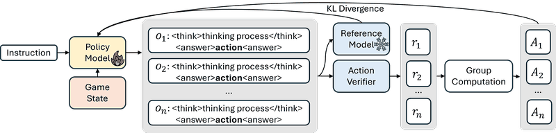

# Think in Games (Honor of Kings replays)

Think in Games is offline action prediction from Honor of Kings replays, not play.

*Diagram of the method: given an instruction and an Honor of Kings game state, the policy model samples several think-then-answer outputs, an action verifier scores each predicted action, and GRPO updates the policy against a frozen reference model (paper figure, no gameplay footage was published). Source: [Think in Games, arXiv 2508.21365, Figure 1](https://arxiv.org/abs/2508.21365).*

| | |
|---|---|
| Year | 2025 |
| Links | [arXiv 2508.21365](https://arxiv.org/abs/2508.21365) |
| Demo | None found (searched: arXiv abstract and HTML paper links, Hugging Face papers/Spaces, GitHub, web search for "Think in Games" demo; only press coverage, no project page, repo or video) |
| Play mode | offline action prediction, not play |

## Details

- In the turn-based or untimed contrast set: Think in Games (offline action prediction from Honor of Kings replays, not play). None of the contrast set has a native clock; a deadline could be imposed but the games do not reward reflexes. They are useful as the "same model, no clock" control.

## Demo

- None found. Searched the arXiv 2508.21365 abstract (no comments field or code link), the paper HTML's external links (only citations), Hugging Face (no models, datasets or Spaces linked to the paper), GitHub repo search, and web search for "Think in Games" Honor of Kings demo/GitHub (only Tencent press coverage and paper summaries).

Searched 10 November 2026; no demo found.

Related: [Think in Games](../solutions/think-in-games.md) (the method)
