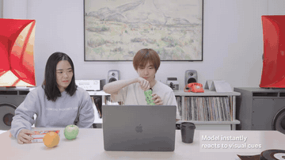

# Thinking Machines TimeSpeak / CueSpeak

TimeSpeak and CueSpeak are Thinking Machines timing benchmarks for interaction models using 200 ms micro-turns; the benchmarks are not released.

*Recording (silent 5 s excerpt) from Thinking Machines' edited "Diet manager" demo video, where a user drinks from a can as the interaction model reacts to visual cues during the conversation; no on-screen clock. Source: [Thinking Machines on YouTube](https://www.youtube.com/watch?v=qXdYDUqxSxA).*

| | |
|---|---|
| Year | May 2026 |
| Links | [blog](https://thinkingmachines.ai/blog/interaction-models/) |
| Demo | [blog](https://thinkingmachines.ai/blog/interaction-models/) and [YouTube](https://www.youtube.com/@thinkymachines): 10 pre-recorded company demo videos of live full-duplex voice/video conversation (interjections, live translation, time awareness, rep counting, tool calls), an animated 200 ms micro-turn diagram, and a page widget comparing recorded audio from TML vs GPT-realtime/Gemini. No games, no try-it access; human-playable: no. |
| Play mode | realtime-live (speech) |
| Clock | 200 ms micro-turns |
| Basis | blog (saved): "continuous input and output streams split into micro-turns"; benchmarks not released |

## Details

- Thinking Machines reports TimeSpeak 64.7 for TML-Interaction-Small against 4.3 for GPT-realtime-2.0, CueSpeak 81.7 against 2.9, RepCount-A 35.4 against 1.3, Charades start/stop 32.4 mIoU against 0 (self-reported).

## Demo

- [video] [Interaction models blog](https://thinkingmachines.ai/blog/interaction-models/) — Scrolled the full blog, clicked three of the 10 YouTube click-to-load posters, seeked the local example-5 video.mp4 (37 s) to 10/50/90%, and viewed the animated Figure 1 and the Example 1-5 audio comparison widget. The 10 company-made office videos cover intro, dialog management, visual and verbal interjection, simultaneous speech (live translation), time awareness, simultaneous tool calls/search, generative UI, 'Diet manager' and 'in-ear' collaboration, with captions such as 'Model instantly reacts to visual cues'. Figure 1 compares turn-based I/O with 200 ms 'time-aligned micro-turns' (1000 ms axis); the widget pairs recorded inputs with pre-recorded output wavs from TML-interaction-small, Gemini-high, Gemini-minimal, GPT-realtime-2 and GPT-realtime-2-xhigh (example 5: a person holds up fingers). Bar charts cover TimeSpeak, CueSpeak, RepCount-A, ProactiveVideoQA and Charades, plus FD-bench (turn-taking latency 0.40 s vs 1.18 s for GPT-realtime-2). Play-mode evidence (recording): static media only (YouTube embeds, /audio/interaction-models/example-N/*.wav, video.mp4), no model API or WebSocket calls; the videos show the model talking while the user talks or moves with no turn-taking pause, but they are edited with no on-screen latency or clock. No game and no public try-it access.
- [video] [Diet manager video](https://www.youtube.com/watch?v=qXdYDUqxSxA) — Opened the 60 s YouTube video and took a frame at 40%: a person drinks a can while the model comments, caption 'Model instantly reacts to visual cues'. The description says the model "parses video, looks up information, and handles interruptions in real time ... This is a preview demo of our interaction model." Edited company video with no latency figures or clock; no game.

Visited 10 November 2026 in a headless browser.

Related: [TML-Interaction-Small](../solutions/tml-interaction-small.md); [Game-Time](game-time.md)
