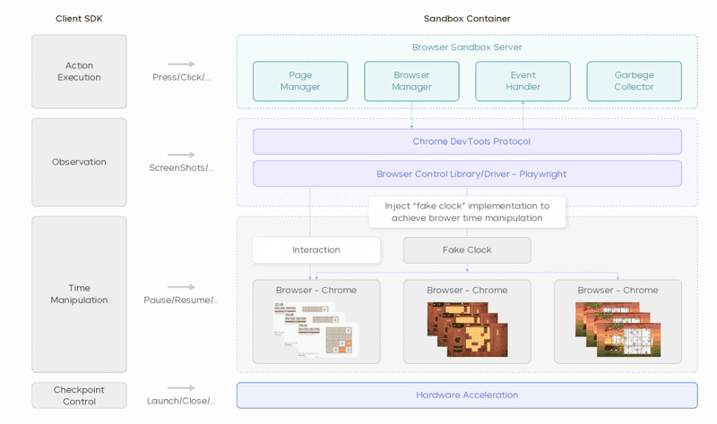

# UI-TARS-2 game suite

UI-TARS-2 is evaluated on 15 browser mini-games in a synchronous browser sandbox with human-normalised scores.

*Architecture diagram (paper Figure 2) of the browser sandbox the games run in: an injected "fake clock" lets the client SDK pause and resume browser time between screenshot observations and press/click actions. Source: [UI-TARS-2 paper, ByteDance Seed (arXiv 2509.02544)](https://arxiv.org/abs/2509.02544).*

| | |
|---|---|
| Year | 2025 |
| Authors / org | ByteDance Seed |
| Links | [arXiv 2509.02544](https://arxiv.org/abs/2509.02544) |
| Demo | [UI-TARS-2 Showcase](https://seed-tars.com/showcase/ui-tars-2/): official project page of seven recorded Agent TARS session replays (web search, coding, Jupyter, page deployment). No game footage, game replays or playable games; nothing shows the model playing against a clock. |
| Play mode | paused-live |
| Clock | Game-TARS web games time-paused; UI-TARS-2 synchronous browser sandbox |
| Observation | screenshots |
| Action | keyboard/mouse |
| Players | 1 |
| Horizon | short |
| Human reference | human-normalised |
| Open source | not released |
| Convertible to realtime-live | un-pause the sandbox |
| Basis | paper 2509.02544 §2.2: clients "receive synchronous observations", "re-implemented Window timing APIs allow time acceleration and pause" |

## Details

- UI-TARS-2 ([arXiv 2509.02544](https://arxiv.org/abs/2509.02544)): 15 browser mini-games, human-normalised scores. Paused-live: §2.2 says clients "receive synchronous observations" and the sandbox's "re-implemented Window timing APIs allow time acceleration and pause".
- Convertibility: the ByteDance sandboxes are not released.

## Demo

- [project-page] [UI-TARS-2 Showcase](https://seed-tars.com/showcase/ui-tars-2/) — Opened it and the card "Use Jupyter To Compare Numbers". The page has no video, iframe or canvas elements. It loads its seven cards from a static file (ui-tars-2-showcase.json), and each card links to a recorded "shared-conversations/agent-tars-...html" session replay. The tasks are "Search Bytedance Seed1.6 News And Deploy Web", "Weight Unit Conversion Query", "Hugging Face Dataset Char Count", "Twin - Island Nation Independence Inquiry", a music-theory course page and "Use Jupyter To Compare Numbers". None of them is a game. Play-mode evidence: none for the 15-game suite. These are recorded tool-use sessions, not live model calls.
- Also checked the seed-tars.com home page, which links the Game-TARS and UI-TARS-1.5 pages but has no UI-TARS-2 game media. The bytedance/UI-TARS README embeds GUI_demo.mp4 and Game_demo.mp4, but they sit under the UI-TARS-1.5 section, so they are not UI-TARS-2 footage.

Visited 10 November 2026 in a headless browser.

Related: [UI-TARS-2](../solutions/ui-tars-2.md) (the model); [Game-TARS game suite](game-tars.md)
