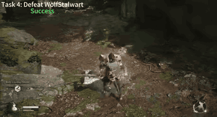

# VARP

VARP is a successor of Cradle that pauses the game using photo mode during VLM inference.

*A 4-second excerpt of the authors' edited recording of the VARP agent fighting the Wolf Stalwart in Black Myth: Wukong (Task 4, captioned "Success"); no inference pauses or clock are visible. Source: [VARP Agent official video](https://www.youtube.com/watch?v=S1OWlF2LALM).*

| | |
|---|---|
| Year | Sep 2024 |
| Play mode | paused-live |
| Clock | game paused during inference |
| Observation | screenshots |
| Action | key/mouse |
| Players | 1 |
| Horizon | one fight |
| Human reference | 10 humans |
| Open source | released; paid game |
| Convertible to realtime-live | poor |
| Basis | VARP paper §4: "During the inference of VLMs, we pause the game using the photo mode" |
| Demo | [project page](https://varp-agent.github.io) with embedded [official video](https://www.youtube.com/watch?v=S1OWlF2LALM) (7:46): edited recording of the VARP agent attempting the Black Myth: Wukong tasks, with per-task success/failure captions. A recording; it does not show inference pauses or a clock, and it is not playable. |

## Details

- Listed with Cradle and CombatVLA as one of Cradle's successors. Basis: VARP paper §4: "During the inference of VLMs, we pause the game using the photo mode".
- Convertibility: poor. Closed commercial Windows games, pausing through the game menu. NitroGen's clock interception (see [NitroGen universal simulator](nitrogen.md)) is the practical route to controlling time in such games.

## Demo

- [project-page] [varp-agent.github.io](https://varp-agent.github.io) — Rendered and read it. Author line: "Anonymous Author(s)". It has the abstract, a framework figure (VARP_Agent.png) and a "Case Studies" figure (case_studies.png) pairing generated action functions with game screenshots. The "Code" and "Dataset" buttons link back to the page itself, so no code is released there. About 200 leftover Nerfies template images (static/interpolation/stacked/*.jpg) return 404. The page makes no model calls.
- [video] [YouTube "Can VLMs Play Action Role-Playing Games? Take Black Myth Wukong as a Study Case"](https://www.youtube.com/watch?v=S1OWlF2LALM) (channel "VARP Agent", 466 s, embedded on the project page) — Played it muted and seeked to several points (headless YouTube loaded the frames up to about 210 s, then showed "Something went wrong" for later seeks). Frames show in-game footage with captions "Task 3: Gather / Success", "Task 4: Defeat WolfStalwart / Success" and a Bullguard fight captioned "Failure" (poster frame). The HUD shows health and stamina bars and the boss health bar. Description: "This video is for scientific research purposes only and has no commercial use." Play-mode evidence: an edited recording. The sampled frames show no photo-mode pauses or inference timing, so the video neither confirms nor contradicts the paused-live label.

Visited 10 November 2026 in a headless browser.

Related: [Cradle](cradle.md); [CombatVLA](combatvla.md)
