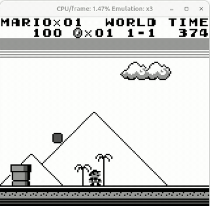

# VideoGameBench / Lite

VideoGameBench asks a model to complete 1990s Game Boy and MS-DOS games from raw frames, with a realtime full mode and a paused Lite mode.

*Recording (cropped to the game window, about 6 s) of the VG-Agent with GPT-4o playing Super Mario Land in real-time mode, where its 3-5 s response delay lets it walk into a Goomba while the in-game TIME counter runs down. Source: [VideoGameBench blog, Figure 6](https://vgbench.com/blog.html).*

| | |
|---|---|
| Year | May 2025 |
| Authors / org | A. Zhang, Griffiths, Narasimhan, Press (Princeton) |
| Links | [arXiv 2505.18134](https://arxiv.org/abs/2505.18134), code [alexzhang13/videogamebench](https://github.com/alexzhang13/videogamebench) (MIT; you must own the games) |
| Demo | [site](https://www.vgbench.com) / [blog](https://vgbench.com/blog.html): static leaderboard plus pre-recorded VG-Agent clips (Kirby, Civ I, Zelda, Incredible Machine, Pokemon Crystal, Super Mario Land and Warcraft II in real-time mode; Doom II in Lite/paused mode), with UI overlays showing step count and $ cost; [practice games](https://vgbench.com/practice-games.html): 3 human-playable turn-based diagnostics (click, maze, drag) with no game clock; human-playable: yes (practice games only), no live model. |
| Play mode | realtime-live (full) + paused-live (Lite) |
| Clock | WALL / emulator pause |
| Observation | screenshots |
| Action | key presses, clicks |
| Players | 1 |
| Horizon | hours |
| Human reference | no numeric |
| Open source | MIT, bring own ROMs |
| Convertible to realtime-live | n/a |
| Basis | code: README `--lite` "pause enabled while model is thinking" (full mode has no pause); paper §2.5 |

## Details

- VideoGameBench (May 2025).
- A. Zhang, Griffiths, Narasimhan, Press (Princeton). [arXiv 2505.18134](https://arxiv.org/abs/2505.18134); code [alexzhang13/videogamebench](https://github.com/alexzhang13/videogamebench) (MIT; you must own the games).
- Tasks: complete 1990s Game Boy and MS-DOS games (Doom II, Kirby's Dream Land, Zelda: Link's Awakening, Civilization I, Pokemon Crystal, three secret games, and others) from raw frames. Emulators: PyBoy, DOSBox/JS-DOS.
- Play modes: full = realtime-live (the game keeps running while the model thinks). Lite = paused-live (`--lite`; "the underlying emulator is paused whenever the agent is processing").
- Scoring: fraction of game completed, by perceptual-hash matching of frames to walkthrough checkpoints. No numeric human baseline.
- Results (v1): Gemini 2.5 Pro 0.48% full / 1.6% Lite; GPT-4o 0.09% / 1.6%. Both modes are near the floor, so the realtime gap is confounded with general failure.
- Useful extras: three practice mini-games (location clicking, mouse dragging, 2D navigation; 10 targets in 250 actions). Dragging was at most 10% for all models.

## Demo

- [video] [VideoGameBench site](https://www.vgbench.com) — Read the static leaderboard (Full: VG-Agent + Gemini 2.5 Pro 0.48%, GPT-4o 0.09%, others 0%; a Lite tab too) and seeked the 6 autoplaying recorded MP4s plus a 30 s teaser: Gemini 2.5 Pro on Kirby (20 s), Civilization I (2:24) and Link's Awakening (2:26), Claude 3.7 on The Incredible Machine (1:07), GPT-4o on Pokemon Crystal (1:43) and GPT-4o on Doom II in Lite (58 s). Each shows the emulator beside the VG-Agent panel with context history, current action, "Steps Taken", "Total Cost" and reflection memory. Play-mode evidence (recordings): captions say Examples 1-5 are played "in real-time" and Example 6 is on Lite "where the environment pauses while the agent thinks"; the Kirby clip is time-compressed ("Total steps: 40, $0.13" at 0:01, "200, $1.03" at 0:09, "260, $1.23" at 0:17), and its reflection memory notes "a confirmed 3-5 second delay in updating the screen"; Pokemon at 0:51 shows "Total steps: 1038, $14.45". No wall-clock or latency readout.
- [video] [VideoGameBench blog](https://vgbench.com/blog.html) — Read the April 2025 research-preview blog and listed its videos (teaser_c.mp4, games.mp4, doom.mp4, doom2_confused_converted.mp4, delay.webm, kirby_converted.mp4). Figure 1 shows 4 models on Doom II in Lite; Figure 6 (delay.webm) shows GPT-4o on Super Mario Land in real time, captioned "the agent takes 3-5 seconds to respond to the current game screen, leading to it dying multiple times to the same Goomba"; Figure 7 shows GPT-4o misclicking in Warcraft II in real time. Play-mode evidence (recordings): captions label each clip as real-time (game keeps running during inference) or Lite (paused).
- [playable] [VideoGameBench practice games](https://vgbench.com/practice-games.html) — Played all three browser diagnostics with Playwright: clicking (reached "Score: 10"), navigation (all 10 mazes, "Congratulations! You beat all levels!") and dragging (levels 1-3, "Level Complete!"). They are human-playable static pages with no AI and no fetch/XHR traffic. Play-mode evidence (played live): the games wait for input (idle 3 s, nothing changed) and have no game clock, so they are turn-based, not a real-time test.

Visited 10 November 2026 in a headless browser.

## Fit

realtime yes; verifiable yes; single yes; human-easy for early checkpoints only; short no.

Related: [PyBoy](pyboy.md)
