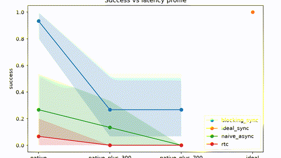

# When Delay Meets Distribution Shift

When Delay Meets Distribution Shift is a robotics setting with simulated asynchronous execution in which queued actions run while the policy computes.

*Result plot from the authors' artifact repo: task success for blocking-sync, naive-async and RTC execution at native latency, the native\_plus\_300 and native\_plus\_700 delay profiles, against an ideal no-latency synchronous run. Source: [vla-latency-benchmark-23CB (anonymous repo)](https://anonymous.4open.science/r/vla-latency-benchmark-23CB/async_vla_benchmark/outputs/figures/success_vs_delay.png).*

| | |
|---|---|
| Year | Dec 2026 |
| Links | [NeurIPS](https://neurips.cc/virtual/2026/162917) |
| Demo | None found (searched: NeurIPS 2026 poster page and its "Project Page" link, the anonymous code repo [vla-latency-benchmark-23CB](https://anonymous.4open.science/r/vla-latency-benchmark-23CB/README.md) (plain README, no media), OpenReview forum 5ji7QDSgJK (blocked by a browser check), web search for a project page or video) |
| Play mode | realtime-live (simulated asynchronous execution) |
| Clock | queued actions run while the policy computes |
| Basis | NeurIPS 2026 page (saved): "Asynchronous execution allows continuous movement in a robot while its policy computes the next action chunk" |

## Demo

- None found. The NeurIPS 2026 poster page (RoboPAD workshop) shows only the abstract, a "Project Page" link and an OpenReview link. The anonymous artifact repo [vla-latency-benchmark-23CB](https://anonymous.4open.science/r/vla-latency-benchmark-23CB/README.md) ("Temporal Coverage Under Shift") is a plain README with code, configs, notebooks and result files under `async_vla_benchmark/outputs/`, with no videos, GIFs or rollout viewer. OpenReview (forum 5ji7QDSgJK) put up a browser check in the headless browser. Web searches for a project page or video found nothing else.

Searched 10 November 2026; no demo found.
