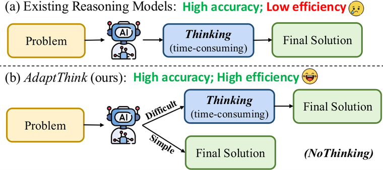

# AdaptThink

AdaptThink trains a reasoning LLM with RL to choose between thinking and not thinking.

*Diagram (paper Figure 1) contrasting existing reasoning models, which always think, with AdaptThink, which thinks on difficult problems and answers directly on simple ones. Source: [Zhang et al., AdaptThink (arXiv 2505.13417)](https://arxiv.org/abs/2505.13417).*

| | |
|---|---|
| Year | 2025 |
| Links | [AdaptThink](https://arxiv.org/abs/2505.13417) |
| Demo | None found (searched: arXiv abstract page, GitHub repo THU-KEG/AdaptThink README and homepage field, Hugging Face paper page, model cards and Spaces search). |
| Category | post-training |
| Method | RL to choose think or no-think |
| Evaluated on | math |
| Evaluation play mode | static |
| Basis | papers: AdaptThink §4 |
| What is trained | reasoning LLM |

## Demo

- None found. The arXiv abstract links only the code repo; the GitHub README (no homepage set) has static result-table images and links to Hugging Face model checkpoints, with no project page, video or interactive demo; the Hugging Face paper page lists no project page, and no Space uses the AdaptThink models.

Searched 10 November 2026; no demo found.

Related: [Thinkless](thinkless.md)
