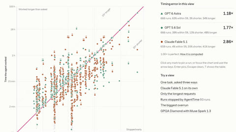

# AgentTime

AgentTime measures whether agents land within 5% of a requested working duration.

*Screenshot of the AgentTime results explorer: each mark is one recorded agent run, plotting the time asked for against the time the agent actually worked (log scales), with per-agent timing error and share within 5%. Source: [AgentTime results explorer](https://agenttimebench.com/results/).*

| | |
|---|---|
| Year | Oct 2026 |
| Links | [arXiv 2610.09944](https://arxiv.org/abs/2610.09944) |
| Demo | [project site and results explorer](https://agenttimebench.com/results/): leaderboard plus an interactive chart of every recorded run (time asked against time worked), with a page per run. Recorded results only; no videos, no live model calls, not something a human can play. |
| Category | scaffold (supporting evidence) |
| Results | agents land within 5% of a requested working duration in 63%, 39% and 4% of runs for three frontier agents |

## Details

- Listed in the supporting evidence that more reasoning hurts under a clock: AgentTime ([arXiv 2610.09944](https://arxiv.org/abs/2610.09944): agents land within 5% of a requested working duration in 63%, 39% and 4% of runs for three frontier agents).

## Demo

- [leaderboard] [AgentTime project site](https://agenttimebench.com) (linked from the arXiv comments and the repo homepage field): I rendered the home page. It shows "Measuring Time Awareness in AI agents", "200 tasks from 18 benchmarks v1.1, 600 runs per agent", a combined-score bar chart (GPT 6 Astra 51%, GPT 6.1 Sol 41%, down to MiMo V2.6 Pro UltraSpeed 6%), and leaderboards for duration following, forecasting and retrospection. In the v1.1 duration-following table, GPT 6.1 Sol (Codex, max reasoning) has 65% of runs within 5% of the time asked and Claude Fable 5.1 has 4%. The page is static: its data comes from bundled JS files (`assets/data/front.js`, `catalog-v11.js`, `forecasts.js`), and I saw no model API calls.
- [replay-viewer] [results explorer](https://agenttimebench.com/results/): a canvas scatter of "Every timed run, asked against worked", covering 1,991 runs in the 26 Sep 2026 data release. The summary matches this file's figures: "GPT 6 Astra ... 63% within 5%", "GPT 5.6 Sol ... 39% within 5%", "Claude Fable 5.1 ... 4% within 5%". I clicked the preset "The biggest overrun", which pins run `wx6psj5cy5`, and opened its [run page](https://agenttimebench.com/runs/wx6psj5cy5/). It shows GPT 5.6 Sol on a WildClawBench task, "Asked for 2 minutes", "Worked 1 h 20 min", "40.00× longer", "Stopped by the safety cutoff", score 0 of 100. It gives a timeline bar and related runs, but no trajectory: "Transcripts are not published yet." The site links a gated Hugging Face dataset, `mofengenden/agenttime-transcripts`, which I did not open. Play-mode evidence: a wall-clock record of finished agent runs (time asked against time worked). There is no game and nothing runs live.

Visited 10 November 2026 in a headless browser.
