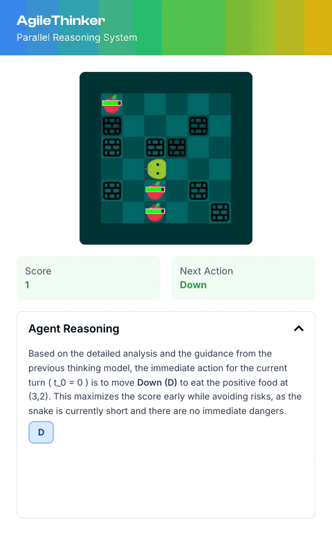

# AgileThinker

AgileThinker is a two-thread scaffold in which a planning thread streams reasoning and a reactive thread reads its partial trace and acts before each deadline.

*A replay of a recorded AgileThinker game of Snake from the RealtimeGym demo, with its Agent Reasoning panel open and updating each turn. The card was resized for capture. Source: [Wen, Ye, Zhang, Yang, Zhu (SALT Lab, Stanford): RealtimeGym interactive demo, realtimegym.saltlab.stanford.edu](https://realtimegym.saltlab.stanford.edu/).*

| | |
|---|---|
| Year | 2025 |
| Authors / org | Wen, Ye, Zhang, Yang, Zhu |
| Links | [arXiv 2511.04898](https://arxiv.org/abs/2511.04898), code in [RealtimeGym](https://github.com/SALT-NLP/RealtimeGym) (MIT) |
| Demo | The [RealtimeGym interactive demo](https://realtimegym.saltlab.stanford.edu/) replays recorded AgileThinker trajectories side by side with the Reactive and Planning agents, with per-step reasoning traces. Not human-playable. |
| Category | scaffold |
| Method | Planning thread streams reasoning; reactive thread reads its partial trace and acts before each deadline |
| Evaluated on | RealtimeGym (Freeway, Snake, Overcooked) |
| Evaluation play mode | realtime-live, token clock |
| Results | 0.90 to 0.58 as pressure rises, against 0.92 to 0.05 for planning alone |
| Open source | code in RealtimeGym, MIT |
| Basis | paper §2: "the environment steps forward at a fixed rate, even when the agent has not finished thinking"; §6 wall-clock run |

## Details

- **AgileThinker** (Wen, Ye, Zhang, Yang, Zhu; ICLR 2026; code in [RealtimeGym](https://github.com/SALT-NLP/RealtimeGym), MIT). The planning thread (DeepSeek-R1) is never interrupted and runs across environment steps. The reactive thread (DeepSeek-V3) starts in the last few thousand tokens of each step with the newest observation and the planner's partial trace. It needs visible reasoning traces, so closed models can only be approximated. At 8k tokens per step on hard load: Freeway 0.06 reactive / 0.10 planning / 0.51 AgileThinker. A wall-clock check used steps of about six minutes. Budget-forcing the reasoning model scored 0.01. No training; the authors list training urgency-aware agents as future work.

## Demo

- [replay-viewer] [RealtimeGym interactive demo](https://realtimegym.saltlab.stanford.edu/) — Not playable by a human; it is a replay viewer. You choose the game (Freeway, Snake, Overcooked), task ID 0-7, cognitive load (Easy/Medium/Hard) and time pressure (Low to Extreme), and Play steps through recorded trajectories loaded from static JSON (console: "Attempting to load: static/data/freeway_hard_4k_seed3_reactive.json"; "Playing at speed: 250 ms per step"). The Reactive Agent, Planning Agent and AgileThinker are shown side by side, each with score, next action and an expandable "Agent Reasoning" trace. At Freeway / Hard / Extreme (4k tokens per step), step 49 of 100, all three were at score 51. Play-mode evidence (recorded replay): consistent with the paper's token clock; the replay is indexed by environment step, and the reasoning shown per step is what the agent produced within that step's token budget. The 250 ms/step playback speed is a viewer setting, not the evaluation clock.

Visited 10 November 2026 in a headless browser.

## What the team could reuse

- Reuse: the baseline scaffold and the gym.
- Baselines: reactive-only, planning-only, AgileThinker (from the scaffolds reuse list).

Related: [Real-Time Reasoning Gym](../environments/realtime-gym.md) (evaluated on; environment details); [TORSI](torsi.md); [DPT-Agent](dpt-agent.md)
