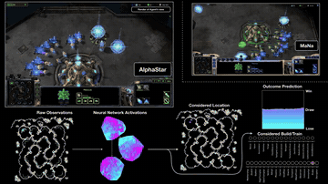

# AlphaStar

AlphaStar played StarCraft II on Battle.net with a camera interface and limits on action frequency agreed with a professional player.

*Recorded replay of game 2 against MaNa from DeepMind's visualisation video, showing AlphaStar's rendered view next to MaNa's screen with its raw observations, network activations, considered location, build choices and outcome prediction. Source: [DeepMind, AlphaStar Agent Visualisation](https://www.youtube.com/watch?v=HcZ48JDamyk).*

| | |
|---|---|
| Year | 2019 |
| Links | [blog](https://deepmind.google/blog/alphastar-grandmaster-level-in-starcraft-ii-using-multi-agent-reinforcement-learning/) |
| Demo | [AlphaStar blog](https://deepmind.google/blog/alphastar-mastering-the-real-time-strategy-game-starcraft-ii/): recorded videos of live real-time matches against TLO and MaNa (about 350 ms average observation-to-action delay at about 280 APM), an [agent-view visualisation video](https://www.youtube.com/watch?v=HcZ48JDamyk) and an interactive [league-strategy map](https://storage.googleapis.com/deepmind-media/research/alphastar/index.html). The replay download link now redirects to the DeepMind homepage. Human-playable: no. |
| Category | RL and decision model |
| Method | camera interface and limits on action frequency agreed with a professional player |
| Evaluated on | StarCraft II |
| Evaluation play mode | realtime-live on Battle.net |
| Basis | docs: DeepMind blog (saved) "viewing the world through a camera, and stronger limits on the frequency of its actions" |

## Details

- **AlphaStar.** The DeepMind announcement says AlphaStar "now has the same kind of constraints that humans play under – including viewing the world through a camera, and stronger limits on the frequency of its actions", and that it "played on the official game server, Battle.net". The Nature paper's exact delay and action-rate numbers could not be read (paywalled), so none are given here.

## Demo

- [project-page] [AlphaStar blog](https://deepmind.google/blog/alphastar-mastering-the-real-time-strategy-game-starcraft-ii/) — Loaded the post on the 5-0 wins over TLO and MaNa; it embeds YouTube cUTMhmVh1qs (MaNa exhibition), UuhECwm31dM and an interactive league-strategy iframe. It says "AlphaStar had an average APM of around 280 ... AlphaStar reacts with a delay between observation and action of 350ms on average", with an APM/delay histogram noting "effective APM bursts are sometimes higher than both players"; the match agent used the raw interface, and a later camera-interface agent lost an exhibition game to MaNa. The "Download all 11 replays" link now redirects to the deepmind.google homepage. Play-mode evidence: recorded videos of live real-time matches against pros; nothing to play.
- [project-page] [AlphaStar League Strategy Map](https://storage.googleapis.com/deepmind-media/research/alphastar/index.html) — Opened the embedded interactive page: a 2D scatter of league agents (TLO Agents 1-5, MaNa Agents 1-5) coloured by strategy cluster, MMR or win rate, with pairwise win rates (e.g. MaNa Agent 1, 7468 MMR, beats TLO Agent 2 86% of the time), unit counts and build probabilities. Static training-league statistics; no gameplay.
- [video] [AlphaStar Agent Visualisation](https://www.youtube.com/watch?v=HcZ48JDamyk) — Opened the 8:43 video of game 2 against MaNa and seeked to 60 s and 400 s (the player time display did not always update after seeking). It shows a "Render of Agent's view" beside MaNa's screen, raw observations, network activations, "Considered Location", "Considered Build/Train" and an "Outcome Prediction" curve. Recorded replay of a live real-time match; no timing or latency numbers on screen.

Visited 10 November 2026 in a headless browser.

Related: [PySC2 / python-sc2](../environments/pysc2-python-sc2.md)
