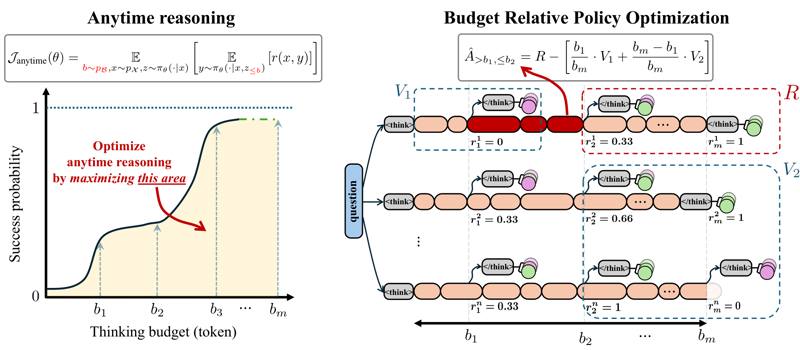

# AnytimeReasoner

AnytimeReasoner trains a reasoning LLM with RL in which thinking is truncated at sampled budgets.

*Paper diagram (Figure 1): left, the anytime objective that maximizes the area under success probability across sampled thinking budgets; right, Budget Relative Policy Optimization, where reasoning is truncated at budgets b1...bm to give dense rewards. Source: [Qi et al., arXiv 2505.13438](https://arxiv.org/abs/2505.13438).*

| | |
|---|---|
| Year | 2025 |
| Links | [arXiv 2505.13438](https://arxiv.org/abs/2505.13438) |
| Demo | None found (searched: arXiv abstract page, GitHub repo sail-sg/AnytimeReasoner README and homepage field, Hugging Face paper page, web search for "AnytimeReasoner demo"). |
| Category | post-training |
| Method | RL with thinking truncated at sampled budgets |
| Evaluated on | math |
| Evaluation play mode | static |
| Basis | paper §3: five math benchmarks at 32 token budgets |
| What is trained | reasoning LLM |

## Details

- **AnytimeReasoner.** The model must give its best answer at randomly sampled truncation points, which yields dense rewards. This is the natural objective for "be interruptible at any time" and maps onto a realtime environment where the deadline is the next tick.

## Demo

- None found. The arXiv page has no comments field or project link; the GitHub repo [sail-sg/AnytimeReasoner](https://github.com/sail-sg/AnytimeReasoner) has no homepage set and its README shows only static result figures (figures/entry.png, figures/main_result_score_curve.png); the Hugging Face paper page lists no Space; web search found only paper and conference pages (NeurIPS 2025).

Searched 10 November 2026; no demo found.

## What the team could reuse

- Reward shaping: AnytimeReasoner's random truncation (from the post-training reuse list).
