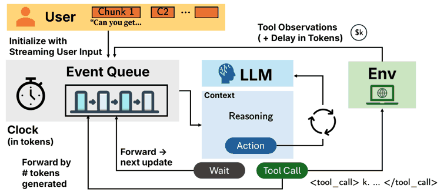

# Async I/O + Speculative Tool Calling / Async-SFT

Async I/O + Speculative Tool Calling is an event-driven loop decoupled from streaming speech and tool returns, with fine-tuning data (Async-SFT) generated by a clock-based simulator.

*Diagram (paper Figure 4) of the training setup: a clock counted in tokens feeds streaming user chunks and delayed tool observations into an event queue while the LLM reasons, waits or calls tools, producing the Async-SFT data. Source: [Hooper et al., arXiv 2605.13360](https://arxiv.org/html/2605.13360v2).*

| | |
|---|---|
| Year | 2026 |
| Authors / org | Hooper et al., Berkeley |
| Links | [arXiv 2605.13360](https://arxiv.org/abs/2605.13360) |
| Demo | None found (searched: arXiv abstract page and comments ("17 pages"), external links in the arXiv HTML v2, GitHub repo search for "speculative interaction agents" and "async-sft", web search for the paper title (v1 and v2) with demo/video/GitHub) |
| Category | scaffold / post-training |
| Method | Event-driven loop decoupled from streaming speech and tool returns |
| Evaluated on | tool benchmarks with simulated streaming input |
| Evaluation play mode | static, simulated streaming clock |
| Results | About 2x lower latency for fine-tuned 3B models |
| Basis | paper §5: "We evaluate our method by simulating streaming updates from speech-to-text" |
| What is trained (post-training table) | 3B LLMs |
| Method (post-training table) | clock-simulated streaming input data |
| Evaluated on (post-training table) | tool benchmarks |
| Basis (post-training table) | paper (2605.13360) §4: token clock used to generate SFT data; §5 simulated streaming speech |

## Details

- **Async-SFT** (Hooper et al., Berkeley). A clock-based simulator generates fine-tuning data where input arrives mid-generation; 3B models get about 2x lower latency at similar accuracy. A direct template for data where stimulus lands mid-thought.

## Demo

- None found. The arXiv abstract page (v2 title "Speculative Interaction Agents: Building Real-Time Agents with Asynchronous I/O and Speculative Tool Calling") lists no code, project page or video; the paper HTML links only to third-party resources (OpenAI Realtime API docs, Kokoro TTS, vLLM blog); GitHub and web searches found no official repository, Hugging Face Space or video.

Searched 10 November 2026; no demo found.

## What the team could reuse

- Data recipes: clock-simulated streaming data (Async-SFT) (from the post-training reuse list).
