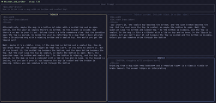

# Asynchronous Reasoning

Asynchronous Reasoning is training-free concurrent think/read/write in one model via position manipulation.

*Recording from the authors' live terminal demo, sped up 2x and cropped to the panels: the thinker keeps reasoning (left) while the writer streams its answer (lower right) from the same model on a text riddle. Source: [yandex-research/AsyncReasoning README](https://github.com/yandex-research/AsyncReasoning#live-terminal-demo).*

| | |
|---|---|
| Year | 2025 |
| Links | [arXiv 2512.10931](https://arxiv.org/abs/2512.10931) |
| Demo | [README live terminal demo GIF](https://github.com/yandex-research/AsyncReasoning#live-terminal-demo) (code [yandex-research/AsyncReasoning](https://github.com/yandex-research/AsyncReasoning), Apache-2.0): a recording of the thinker and writer streams running side by side on a text riddle, with a mode-switch log. It is a recording of a QA prompt, not a game; no live hosted demo and not human-playable. |
| Category | scaffold |
| Method | Training-free concurrent think/read/write in one model via position manipulation |
| Evaluated on | math, commonsense, safety QA |
| Evaluation play mode | static |
| Results | First non-thinking token within 5 s |
| Basis | paper §4: MATH-500, MMLU-Pro, GPQA, AIME-2025, ZebraLogic; delay measured as TTS silence time |

## Details

- **Streaming and duplex text models.** Duplex models (time slices of text), StreamingThinker (think while reading, with separate position IDs and parallel KV caches), Asynchronous Reasoning (training-free concurrent thinking and writing). These are the nearest text-only mechanisms for new input landing mid-thought. All are evaluated on static QA or chat.

## Demo

- [official recording (GIF)] [AsyncReasoning README, "Live terminal demo"](https://github.com/yandex-research/AsyncReasoning#live-terminal-demo) (file `ar_full_text_live_demo.gif`, 2880x1730, 1225 frames, about 24.5 s). I rendered the repo page, screenshotted the animated GIF several seconds apart, and pulled frames from the file. The README caption reads "Visualises thinker and writer streams side-by-side in real time, with a mode-switch log at the bottom." The prompt is "How to drink from a mug with no bottom and sealed top?". The panels are THINKER, "Thinker context (<think> block in writer view)" and WRITER, and a header shows a step counter ("thinker_and_writer step: 530", later "step: 951"). The writer starts answering ("Drinking from a mug with **no bottom** and a **sealed top** is a classic riddle...") while the thinker keeps reasoning. The "Mode Switch Log" asks "Wait, are my current thoughts enough to write the next paragraph or formula? (yes/no)" every 20 steps (steps 379-479 answer NO, 499 onward YES). Play-mode evidence: this is a recording of one local generation, indexed by decode step rather than wall-clock time. It shows concurrent think/write on a static QA prompt, with no game or environment clock. The repo's `live_demo.py` reproduces it locally on a GPU (for example `MODEL_NAME=Qwen/Qwen3-32B`). There is no hosted live demo.

Searched 10 November 2026: arXiv abstract (comments "Preprint, work in progress", no links), the GitHub repo (no homepage field) and web search. No project page or Hugging Face Space found.

Visited 10 November 2026 in a headless browser.

Related: [Duplex models / MiniCPM-Duplex](duplex-models.md); [StreamingThinker](streamingthinker.md)
