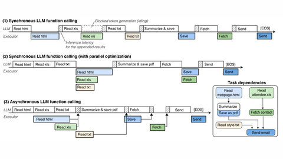

# AsyncLM

AsyncLM keeps generating while tools run and uses interrupt tokens on return.

*Paper figure (diagram) comparing LLM and executor timelines for synchronous, parallel-synchronous and asynchronous function calling, where AsyncLM keeps generating while tools run and results return as interrupts. Source: [Gim et al., arXiv 2412.07017, Figure 2](https://arxiv.org/abs/2412.07017).*

| | |
|---|---|
| Year | Dec 2024 |
| Links | [arXiv 2412.07017](https://arxiv.org/abs/2412.07017) |
| Demo | None found (searched: arXiv abstract page (no comments or code links), web search for "AsyncLM demo" and "Asynchronous LLM Function Calling" code; only an unofficial third-party reimplementation, github.com/kaelzhang/async-lm, turned up) |
| Category | scaffold |
| Method | Keep generating while tools run; interrupt tokens on return |
| Evaluated on | BFCL |
| Evaluation play mode | static |
| Results | 1.6-5.4x lower latency |
| Basis | paper §6: BFCL tasks; task completion latency |

## Demo

- None found. The arXiv abstract page lists no comments, project page or code. Web searches for "AsyncLM demo" and for the paper title turned up no official repository, video or live demo. The only code was an unofficial third-party reimplementation (github.com/kaelzhang/async-lm), which is not a demo by the authors.

Searched 10 November 2026; no demo found.
