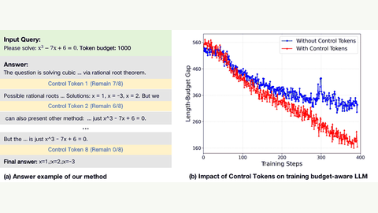

# BudgetThinker

BudgetThinker inserts periodic remaining-budget tokens and trains with SFT and RL.

*Figure from the paper: (a) an example answer with periodic control tokens reporting the remaining budget (7/8 down to 0/8), and (b) a plot showing that control tokens shrink the length-budget gap during training. Source: [Wen et al., BudgetThinker, arXiv 2508.17196, Figure 1](https://arxiv.org/html/2508.17196).*

| | |
|---|---|
| Year | Aug 2025 |
| Links | [arXiv 2508.17196](https://arxiv.org/abs/2508.17196) |
| Demo | None found (searched: arXiv abstract page, GitHub repo MobileLLM/BudgetThinker README and homepage field, web search for "BudgetThinker demo"; only model weights and a dataset on Hugging Face, no Space, video or project page). |
| Category | post-training |
| Method | periodic remaining-budget tokens; SFT + RL |
| Evaluated on | (not extracted) |
| Evaluation play mode | static |
| Basis | paper §3.1 Evaluation Details |
| What is trained | reasoning LLM |

## Demo

- None found. The arXiv abstract page lists no project page or code links; the GitHub repo [MobileLLM/BudgetThinker](https://github.com/MobileLLM/BudgetThinker) has no homepage field and its README has only training and evaluation instructions plus links to the paper, [Dataset-BudgetThinker](https://huggingface.co/datasets/Xin-Rui/Dataset-BudgetThinker) and [BudgetThinker-1.5b](https://huggingface.co/Xin-Rui/BudgetThinker-1.5b) weights (no GIFs, videos or Space). A web search for "BudgetThinker demo" found only the paper and summaries of it.

Searched 10 November 2026; no demo found.
