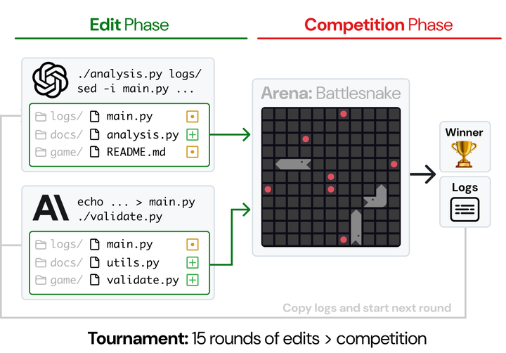

# CodeClash

In CodeClash LLMs write bots whose code competes in arenas; "LMs do not play the games directly".

*Paper diagram (Figure 1, cropped to the loop): in each round two models edit their codebases with shell commands, then their bots compete in an arena (here Battlesnake), and the logs are copied back for the next of 15 rounds. Source: [CodeClash paper, arXiv 2511.00839](https://arxiv.org/html/2511.00839).*

| | |
|---|---|
| Year | Nov 2025 |
| Links | [arXiv 2511.00839](https://arxiv.org/abs/2511.00839) |
| Demo | [CodeClash Trajectory Viewer](https://viewer.codeclash.ai/): recorded tournament logs with per-round winners, cost and the full agent edit-phase transcripts and diffs; [project site](https://codeclash.ai/) has an Elo leaderboard and recorded arena animations. All recordings; no live model play against a clock; not human-playable. |
| Category | scaffold |
| Method | LLM writes code, behaviour trees or bots |
| Evaluated on | Minecraft, 3D games, code arenas |
| Evaluation play mode | scripted (Voyager also pauses the server during LLM calls) |
| Results | out of scope |
| Basis | CodeClash paper §2 "LMs do not play the games directly" |

## Demo

- [replay viewer] [CodeClash Trajectory Viewer](https://viewer.codeclash.ai/) — Opened the run `PvpTournament.RobotRumble.r15.s1000.p2.gemini-2.5-pro.gpt-5-mini.251006010532` and expanded a trajectory. It shows per-round results (gpt-5-mini won rounds 1-6 at 1000-0.0), edit-phase stats ("API CALLS: 11", "COST: $0.15", "EXIT STATUS: Submitted") and the model's shell-command transcript under a step budget ("step 1 (30 limit)", "1.0 USD limit"), plus diffs. Play-mode evidence (recorded): static HTML logs, no model calls on the network; the LLM writes bot code between rounds and does not act during matches.
- [project page] [CodeClash site](https://codeclash.ai/) — Read the leaderboard ("Updated Nov. 3, 2025") and the RobotRumble arena page with an animated recorded match (`robotrumble.gif`, "Turn 3" counter). Play-mode evidence (recording): turn-based replay of bot code, not of a model.

Visited 10 November 2026 in a headless browser.

Related: [CodeClash](../environments/codeclash.md) (environment details); [Voyager](voyager.md); [PORTAL](portal.md)
