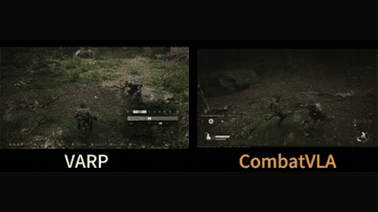

# CombatVLA

CombatVLA is a 3B VLA for Black Myth: Wukong that outputs the action first and truncates the explanation at inference.

*Recording from the authors' inference-speed comparison video, played at 2x speed: VARP (left) and CombatVLA (right) fight in Black Myth: Wukong with the game paused during each model call, so frozen stretches show inference time. Source: [CombatVLA project page](https://combatvla.github.io/).*

| | |
|---|---|
| Year | 2025 |
| Links | [arXiv 2503.09527](https://arxiv.org/abs/2503.09527) |
| Demo | [project page](https://combatvla.github.io/): two pre-recorded videos. One shows the model completing 13 Black Myth: Wukong combat tasks with the game pauses during inference edited out. The other is a side-by-side inference-speed comparison with VARP that keeps the pauses (about 1.8 s per call). The game waits for the model. Human-playable: no. Live demo: no. |
| Category | RL and decision model / post-training |
| Method | 1.85 s per step |
| Evaluated on | Black Myth: Wukong |
| Evaluation play mode | paused-live |
| Basis | paper §4: "the agent pauses the game during model inference and resumes the game when executing actions" |
| What is trained (post-training table) | 3B VLA; action first, explanation truncated at inference |
| Method (post-training table) | SFT |
| Basis (post-training table) | paper §4: "the agent pauses the game during model inference" |

## Details

- **CombatVLA.** Output is action, then a truncation token, then explanation; generation stops at the truncation token at inference. A simple way to train with reasoning supervision and skip it at run time.

## Demo

- [video] [CombatVLA project page](https://combatvla.github.io/) — Loaded the page and seeked through its two recorded videos (task1_13.mp4, 6:49, and comparison.mp4, 0:40); nothing is interactive and the network log shows only the two static mp4 files, so this was seen in recordings, not run live. The task video shows a Windows game window titled "b1" (Black Myth: Wukong) with captions such as "Task 1: Defeat WolfScout (Easy)", "Task 8: Defeat Bullguard (Hard)" and "Task 10: Defeat Guangzhi (Very Hard)"; the page says the videos also include Sekiro. The "Comparison on Inference Speed" video shows VARP and CombatVLA side by side, and by 35 s CombatVLA has finished while VARP is still fighting. Play-mode evidence: the game waits for the model; the paper (arXiv 2503.09527 v2, Sec 14) says the task video has "edited out the game pauses" and the comparison keeps them, "the pause duration representing the inference time" (about 1.8-1.85 s per call for CombatVLA vs about 90 s for VARP); no tick counter or latency overlay is visible in the frames.

Visited 10 November 2026 in a headless browser.

## What the team could reuse

- Data recipes: action-first with truncated explanation (from the post-training reuse list).

Related: [CombatVLA](../environments/combatvla.md) (environment details)
