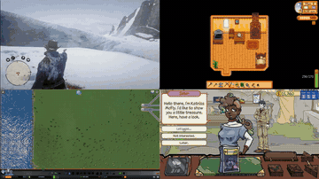

# Cradle

Cradle is a six-module GPT-4o pipeline that writes code skills to play commercial games.

*Recordings of four separate Cradle runs (RDR2, Stardew Valley, Cities: Skylines, Dealer's Life 2) tiled into a 2x2 grid: the opening 4 s of the authors' intro montage, with sped-up game footage (the source videos are labelled 16x). Source: [Cradle project page](https://baai-agents.github.io/Cradle/).*

| | |
|---|---|
| Year | 2024 |
| Links | [arXiv 2403.03186](https://arxiv.org/abs/2403.03186) |
| Demo | [Project page](https://baai-agents.github.io/Cradle/): official recorded videos of Cradle playing RDR2, Stardew Valley, Cities: Skylines and Dealer's Life 2 (plus five software apps), all titled "at 16x speed". Recordings only; no live run, replay viewer or human-playable page. |
| Category | scaffold |
| Method | Six-module GPT-4o pipeline writing code skills |
| Evaluated on | RDR2, Stardew and others |
| Evaluation play mode | paused-live in every environment |
| Results | about 62 s per decision |
| Basis | code: `cradle/provider/execute/skill_execute.py` (unpause -> skill -> pause); paper §4 "we must pause those game environments" |

## Demo

- [project page with videos] [Cradle project page](https://baai-agents.github.io/Cradle/) — I rendered the page, played the 16 s intro montage (`video/whole_video.mp4`) and seeked two of the embedded YouTube videos. It has five game videos (RDR2 main storyline 7:27, RDR2 open-ended 1:25, Stardew Valley 5:56, Cities: Skylines, Dealer's Life 2) and five software videos. Every YouTube title ends "(at 16x speed)". Frame overlays read "Mission 1: Search Barn X16" in RDR2 at 3:22 and "Task 1: Farm Clearup" in Stardew at 1:00. Play-mode evidence: these are sped-up recordings with no visible model latency or pauses, so they say nothing about the about 62 s per decision.

Visited 10 November 2026 in a headless browser.

Related: [Cradle](../environments/cradle.md) (environment details); [Lumine](lumine.md) (its benchmark baselines follow Cradle's pause setup)
