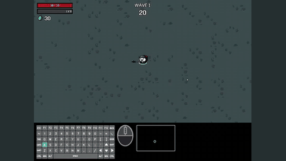

# D2E

D2E provides an open recorder with synchronised screen and input timestamps.

*Recording of human Brotato play from YouTube (wave timer visible) with the Generalist-IDM's inferred keyboard and mouse actions overlaid below; this is offline action labeling, not an agent playing. Source: [D2E project page](https://worv-ai.github.io/d2e/).*

| | |
|---|---|
| Links | [arXiv 2510.05684](https://arxiv.org/abs/2510.05684) |
| Demo | [project page](https://worv-ai.github.io/d2e/): pre-recorded mp4s of human game footage (YouTube and OWA recordings across 8+ games, plus Battlefield 6 and Ogu as out-of-distribution games) with the Generalist-IDM's inferred keyboard/mouse actions overlaid. This is offline action labeling, not an agent playing. Robot rollout videos (LIBERO, CANVAS, SO-101) are also on the page. Human-playable: no; no live or interactive demo. |
| Category | RL and decision model (game foundation and action models) |

## Details

- **D2E** ([arXiv 2510.05684](https://arxiv.org/abs/2510.05684)) provides an open recorder with synchronised screen and input timestamps, useful for collecting human baselines.

## Demo

- [project-page] [D2E project page](https://worv-ai.github.io/d2e/) — Loaded the page, listed its 41 video elements, scrolled with screenshots and seeked the first 4 autoplay videos to 2 s and 10 s; network requests were all static mp4s from /d2e/static/videos/, so everything was seen in recordings. "Pseudo-Label result on YouTube dataset" has eight 2-minute videos (Brotato, CSGO2, Stardew Valley, Minecraft, Slime Rancher, Raft, Barony, Dinkum) of human gameplay with the Generalist-IDM's inferred keyboard/mouse actions overlaid (e.g. a Brotato frame at 0:10 with WAVE 1 and an 18 s wave timer); further sections compare Ground Truth, IDM and G-IDM on Brotato and Minecraft, out-of-distribution Battlefield 6 and Ogu and the Secret Forest with mouse-position plots, and LIBERO, CANVAS and SO-101 robot rollouts (baseline vs VAPT). Play-mode evidence: no game video shows an agent playing; it is offline inverse-dynamics labeling of recorded human play, so neither live nor game-waiting play applies. Links: arXiv 2510.05684, GitHub worv-ai/D2E, HF model open-world-agents/Generalist-IDM-1B and datasets D2E-480p / D2E-Original.

Visited 10 November 2026 in a headless browser.