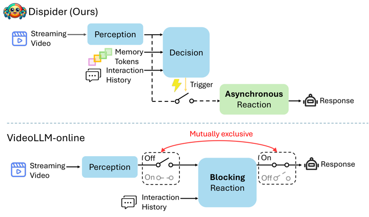

# Dispider

Dispider separates perception, decision and asynchronous reaction modules for streaming video.

*Diagram (paper Figure 1) of Dispider's streaming-video perception module, a decision module that also reads memory tokens and interaction history, and an asynchronous reaction module it triggers, set against VideoLLM-online's blocking reaction. Source: [Qian et al., arXiv 2501.03218](https://arxiv.org/abs/2501.03218).*

| | |
|---|---|
| Year | Jan 2025 |
| Links | [arXiv 2501.03218](https://arxiv.org/abs/2501.03218) |
| Demo | None found (searched: arXiv abstract and comments, GitHub repo Mark12Ding/Dispider README, homepage field and file tree (only img/logo.png and img/pipeline.png), CVPR 2025 poster page (its "Project Page" link points to the GitHub repo), Hugging Face model card Mar2Ding/Dispider and Spaces search, web search for "Dispider demo"/project page/video) |
| Category | realtime architecture |
| Method | Separate perception, decision and asynchronous reaction modules |
| Evaluation play mode | offline replay |
| Open source | research |
| Basis | paper §1: evaluated on StreamingBench and offline long-video benchmarks |
| Channels (in / out) | video / text |
| Tick | per clip |

## Details

- **Streaming video LLMs** (VideoLLM-online, Flash-VStream, Dispider, StreamBridge, LiveCC, StreamingVLM, OmniMMI/M4, Proact-VL). The only "action" is when to speak. Evaluations replay recorded video and mostly score offline.

## Demo

- None found. The CVPR 2025 poster page's "Project Page" button links to the GitHub repo [Mark12Ding/Dispider](https://github.com/Mark12Ding/Dispider), whose README has only a pipeline diagram plus offline and incremental inference instructions (no videos, GIFs or demo). The GitHub homepage field is empty, the [Hugging Face checkpoint](https://huggingface.co/Mar2Ding/Dispider) has no demo, no Hugging Face Space references arXiv 2501.03218, and a web search turned up no demo video.

Searched 10 November 2026; no demo found.

Related: [StreamingBench](../environments/streamingbench.md) (evaluated on)
