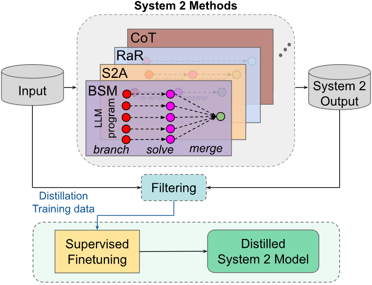

# Distilling System 2 into 1

Distilling System 2 into 1 is a post-training method listed with Dualformer (signal: train on randomly dropped reasoning traces; distil).

*Figure 1 of the paper (diagram): System 2 methods (CoT, RaR, S2A, BSM) produce outputs on unlabeled inputs, which are filtered and used to fine-tune the model into a distilled System 1 model. Source: [Yu et al., Distilling System 2 into System 1 (arXiv 2407.06023)](https://arxiv.org/html/2407.06023v3).*

| | |
|---|---|
| Year | 2024 |
| Category | post-training |
| Method | train on randomly dropped reasoning traces; distil |
| Evaluated on | mazes, QA |
| Evaluation play mode | static |
| Basis | Distilling §4 |
| What is trained | transformer / LLM |
| Demo | None found (searched: arXiv 2407.06023 abstract page (no comments or code link), Hugging Face Spaces, web search for project page, GitHub repo and demo) |

## Demo

- None found. The item file has no links; the arXiv abstract page for 2407.06023 (Yu, Xu, Weston, Kulikov, Meta FAIR) has no comments field or code link, Hugging Face Spaces search returned nothing, and a web search turned up only the paper and mirrors (ar5iv, NeurIPS 2024 Sys2-Reasoning workshop listing). The work is an offline distillation method evaluated on static tasks, with no project page, video, or viewer.

Searched 10 November 2026; no demo found.

Related: [Dualformer](dualformer.md)
